# Catatan Pengerjaan CPT (VLSM) - Modul 4 Komdat Jarkom 2026, Kelompok K-57

Catatan ini disusun berurutan sesuai langkah yang dikerjakan di Cisco Packet Tracer (CPT) 9.0.1. Setiap langkah berisi tujuan, nilai yang dimasukkan, alasan nilai tersebut, hasil yang teramati, dan bukti tangkapan layar (folder `../Assets/CPT/`). Rancangan alamat berasal dari `Pembagian-IP-VLSM.xlsx` (akar `10.92.0.0/19`) dan panduan `CPT-Build-Guide.md`.

Tanggal pengerjaan: Kamis, 5 November 2026 (WIB).

## 0. Kondisi awal (audit)

Pada awal sesi lanjutan, kondisi proyek CPT yang terbuka adalah:

| Item | Kondisi |
|---|---|
| Router terkonfigurasi | Cyberia, Wired, Navi (3 dari 13) |
| Cabang Navi | Selesai: tiga LAN (A11, A12, A13) dan enam host, semua ping dari JJ berhasil |
| Tachibana | Belum dikonfigurasi (masih di dialog konfigurasi awal), modul NM-1FE-TX terpasang (3 antarmuka FastEthernet) |
| Deus | **Mati (power off)**. CLI menolak dengan pesan "Device must be powered on" dan melaporkan hanya 2 antarmuka. Setelah saklar daya dihidupkan, router melaporkan 3 antarmuka FastEthernet, sehingga modul NM-1FE-TX sudah terpasang dengan benar |
| Kabel | 15 dari 51 terpasang |
| Perangkat lain | Router Protocol7, Knights, Phantoma, Psyche, Copland, Schumann, Accela, Shibuya sudah ditempatkan tetapi belum dikonfigurasi dan belum dikabel |

Pelajaran: indikator daya yang andal adalah lampu hijau di samping saklar daya pada tab Physical, dan modul hanya dapat dipasang saat router mati.

## 1. Konfigurasi router (Fase 4 dan 5, bagian CLI)

### Metode

Setiap router dikonfigurasi dengan satu blok perintah dari `CPT-Build-Guide.md` bagian 5. Blok dimuat ke clipboard lalu ditempel dengan tombol **Paste** pada tab CLI, bukan diketik karakter demi karakter, agar tidak ada baris yang hilang. Setelah ditempel, keluaran CLI dibaca kembali untuk memastikan setiap baris diterima dan `write memory` menampilkan `[OK]`.

Urutan awal pada router baru: jawab `no` pada dialog "initial configuration dialog", tekan Enter sampai prompt `Router>`, lalu tempel blok.

Catatan: antarmuka tampil `changed state to down` setelah blok ditempel. Ini wajar karena kabel belum dipasang; status berubah menjadi up setelah kabel dipasang.

### Prinsip routing yang dipakai (untuk demo)

- Setiap router memiliki **default route ke router induknya** (arah Cyberia dan Cloud).
- Setiap router memiliki **rute ringkasan (summary) yang tepat** untuk subnet di bawahnya. Ringkasan dibuat sedemikian rupa sehingga hanya mencakup subnet yang benar-benar dialokasikan. Akibatnya paket ke alamat yang tidak dipakai dibuang, bukan memantul antarrouter (tidak ada routing loop).
- Cyberia adalah akar, sehingga tidak memiliki default route ke dalam, melainkan 5 ringkasan dengan next hop Wired.
- Total rute statis: 55.

### Hasil per router

| Router | Antarmuka dan alamat | Rute statis | Bukti |
|---|---|---|---|
| Tachibana | Fa0/0 `10.92.16.70/30` (A14), Fa0/1 `10.92.10.1/23` (A15), Fa1/0 `10.92.16.73/30` (A16) | default ke `10.92.16.69` + 7 ringkasan via Deus `10.92.16.74` | 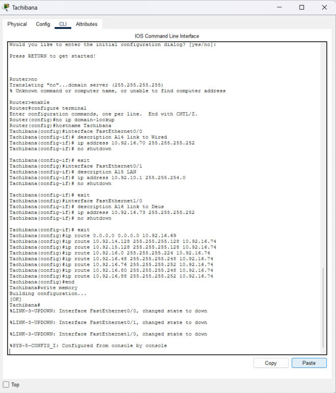 |
| Deus | Fa0/0 `10.92.16.74/30` (A16), Fa0/1 `10.92.14.129/25` (A17), Fa1/0 `10.92.16.77/30` (A18) | default ke `10.92.16.73` + 5 rute via Protocol7 `10.92.16.78` | 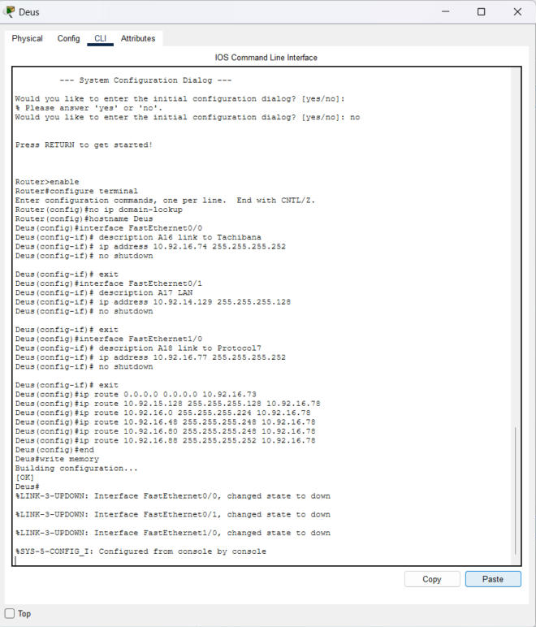 |
| Protocol7 | Fa0/0 `10.92.16.78/30` (A18), Fa0/1 `10.92.15.129/26` (A19), Fa1/0 `10.92.16.81/30` (A20) | default ke `10.92.16.77` + 5 rute via Knights `10.92.16.82` | 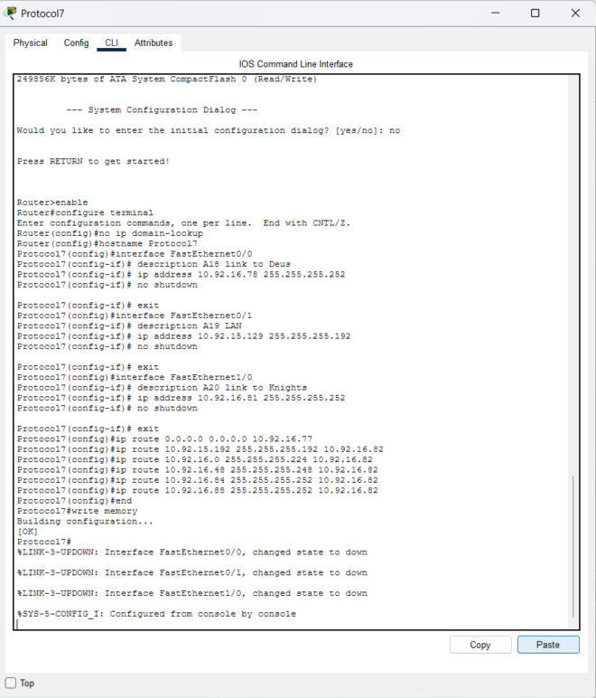 |
| Knights | Fa0/0 `10.92.16.82/30` (A20), Fa0/1 `10.92.16.49/29` (A21), Fa1/0 `10.92.16.85/30` (A22) | default ke `10.92.16.81` + 3 rute via Phantoma `10.92.16.86` | 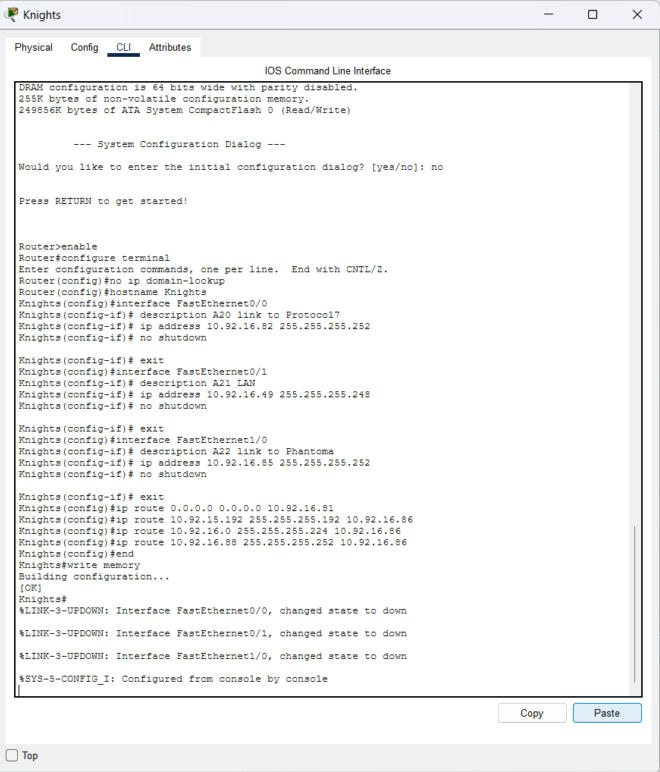 |
| Phantoma | Fa0/0 `10.92.16.86/30` (A22), Fa0/1 `10.92.16.1/27` (A23), Fa1/0 `10.92.16.89/30` (A24) | default ke `10.92.16.85` + 1 rute ke LAN A25 via Shibuya `10.92.16.90` | 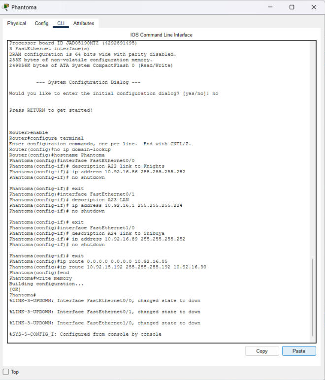 |
| Shibuya | Fa0/0 `10.92.16.90/30` (A24), Fa0/1 `10.92.15.193/26` (A25) | default ke `10.92.16.89` | 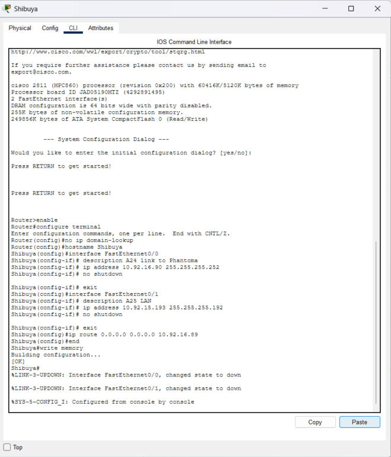 |
| Psyche | Fa0/0 `10.92.16.34/29` (A3), Fa0/1 `10.92.0.1/22` (A4) | default ke Wired `10.92.16.33` | 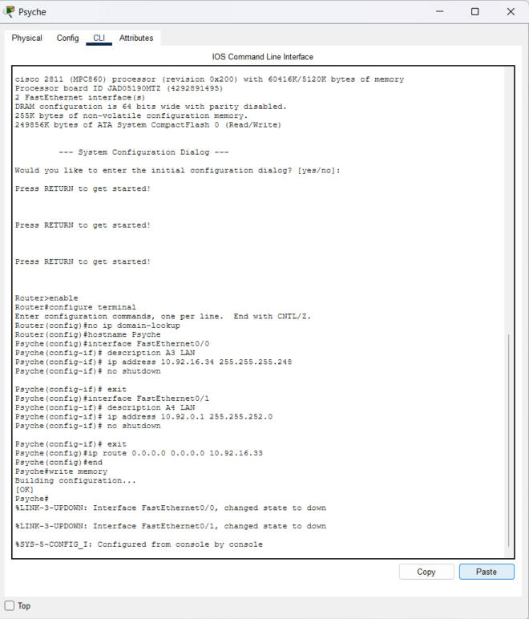 |
| Copland | Fa0/0 `10.92.16.35/29` (A3), Fa0/1 `10.92.15.1/26` (A5), Fa1/0 `10.92.8.1/23` (A6) | default ke Wired `10.92.16.33` | 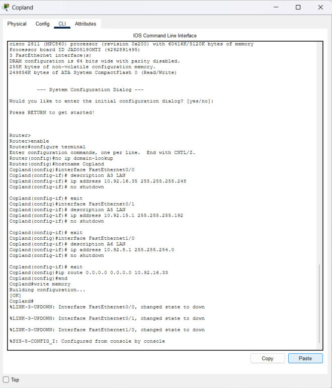 |
| Schumann | Fa0/0 `10.92.16.36/29` (A3), Fa0/1 `10.92.16.41/29` (A7), Fa1/0 `10.92.16.61/30` (A8) | default ke Wired `10.92.16.33` + rute LAN A9 via Accela `10.92.16.62` | 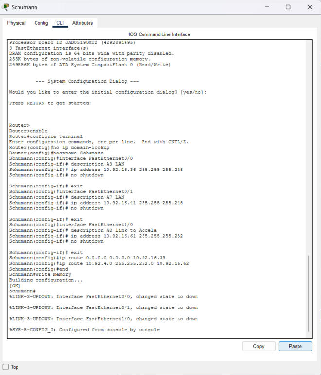 |
| Accela | Fa0/0 `10.92.16.62/30` (A8), Fa0/1 `10.92.4.1/22` (A9) | default ke Schumann `10.92.16.61` | 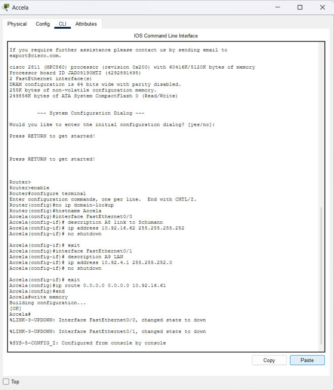 |

Cyberia, Wired, dan Navi sudah dikonfigurasi pada sesi sebelumnya (lihat `cpt-navi-cli-config.png`). Dengan langkah ini, 13 dari 13 router sudah dikonfigurasi.

### Kendala dan penanganan

- Dialog perangkat CPT kadang terbuka di belakang jendela utama. Penanganan: buka menu **Window** pada CPT, yang mendaftar semua dialog perangkat yang terbuka, lalu pilih nama perangkat.
- Pada percobaan pertama Tachibana, jawaban `no` terlanjur diketik saat router sudah berada di prompt `Router>`, sehingga IOS mencoba menerjemahkan `no` sebagai nama host (DNS lookup). Hal ini hanya menunda beberapa detik dan tidak mengubah konfigurasi; baris `no ip domain-lookup` pada blok mencegahnya di langkah berikutnya.
- Saat satu dialog tidak terbuka di depan, penekanan tombol tersalur ke ruang kerja utama dan sempat mengaktifkan alat Inspect. Alat Select dipilih kembali dan topologi tidak berubah.

## 2. Penataan ulang tata letak sesuai topologi soal

### Tujuan

Menyusun letak seluruh perangkat pada ruang kerja logis CPT agar sama persis dengan gambar topologi resmi pada soal (`topo-modul4-cpt.png`): `Cloud` dan `Cyberia` di sisi kiri, `Wired` sebagai pusat percabangan di tengah kiri, cabang `Navi` di bagian atas tengah, cabang `Switch2` (`Psyche`, `Copland`, `Schumann`, `Accela`) di bagian bawah tengah, dan rantai memanjang `Tachibana -> Deus -> Protocol7 -> Knights -> Phantoma -> Shibuya` dari atas tengah ke sisi kanan.

### Hasil yang teramati dan bukti

Seluruh router yang sudah dikonfigurasi disusun ulang di kanvas tanpa menghapus konfigurasi NVRAM maupun antarmuka yang telah tersimpan:

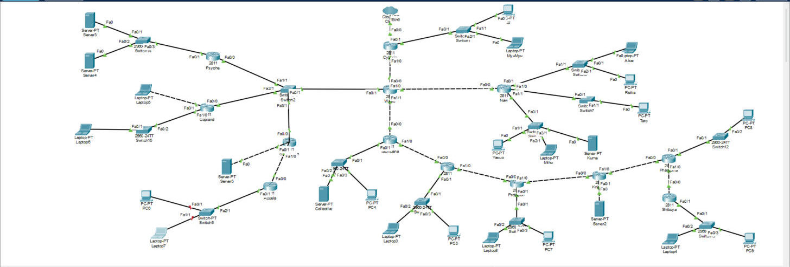

## 3. Penempatan dan penamaan switch serta host

### Tujuan dan alasan pemilihan perangkat

Menambahkan sisa switch dan host akhir sesuai dengan jenis ikon perangkat dan nama pada gambar soal `topo-modul4-cpt.png`:

1. **Switch (13 unit `2960-24TT`)**: `Switch1` sampai `Switch13`. Dua belas switch melayani segmen LAN host, sedangkan `Switch2` menjadi segmen transit bersama (subnet `A3`, `/29`) yang menghubungkan 4 router sekaligus (`Wired`, `Psyche`, `Copland`, dan `Schumann`). Tiga segmen LAN berkapasitas 1 host (`A5` untuk `Juri`, `A7` untuk `Akashic`, dan `A21` untuk `Eiri`) tidak menggunakan switch karena pada gambar soal perangkat host terhubung langsung ke antarmuka router.
2. **Host akhir (25 unit)**:
   - **PC-PT (12 unit)**: `JJ`, `MyuMyu`, `Masayuki`, `Omnipresence`, `Alice`, `Taro`, `Yasuo`, `Miho`, `Ghost`, `Specter`, `Chisa`, `Lain`.
   - **Laptop-PT (8 unit)**: `Juri`, `Denpa`, `Reika`, `Kuma`, `Lilith`, `Hodgeson`, `Semi`, `Mika`.
   - **Server-PT (5 unit)**: `Karl`, `Lin`, `Akashic`, `Collective`, `Eiri`.

Setiap perangkat langsung diberi *Display Name* yang persis sama dengan soal (peka huruf besar-kecil) agar tidak tertukar saat pengkabelan dan pengujian.

## 4. Pengkabelan (51 kabel) dan aturan pemilihan jenis kabel

### Aturan jenis kabel di CPT

Pemilihan jenis kabel mengikuti kesamaan lapisan operasi port perangkat:

- **Copper Straight-Through (39 kabel)**: dipasang pada seluruh sambungan berbeda jenis port, yaitu `Router <-> Switch` (16 sambungan), `Switch <-> PC-PT / Laptop-PT / Server-PT` (22 sambungan), serta `Cloud-PT (Ethernet6) <-> Cyberia (Fa0/0)` (1 sambungan).
- **Copper Cross-Over (12 kabel)**: dipasang pada sambungan sejenis port MDI/MDI-X tanpa Auto-MDIX pada router `PT-Router`, yaitu:
  - 9 sambungan langsung antarrouter (`Cyberia-Wired`, `Wired-Navi`, `Wired-Tachibana`, `Tachibana-Deus`, `Deus-Protocol7`, `Protocol7-Knights`, `Knights-Phantoma`, `Phantoma-Shibuya`, `Schumann-Accela`).
  - 3 sambungan langsung `Router <-> Host` tanpa switch karena NIC host (`PC-PT`, `Laptop-PT`, `Server-PT`) memiliki pinout MDI yang sama dengan port `FastEthernet` router: `Copland (Fa0/1) <-> Juri`, `Schumann (Fa0/1) <-> Akashic`, dan `Knights (Fa0/1) <-> Eiri`.

## 5. Pengalamatan IPv4 dan Default Gateway pada seluruh host

### Metode dan alasan penentuan alamat

Pada setiap subnet LAN di `Pembagian-IP-VLSM.xlsx`, alamat usable pertama (`.1`, `.33`, `.41`, `.49`, `.65`, `.129`, atau `.193` sesuai batas blok VLSM) diberikan kepada antarmuka LAN router sebagai **Default Gateway** bagi seluruh host di subnet tersebut. Host pertama dan berikutnya pada setiap LAN menerima alamat usable selanjutnya secara berurutan.

| Subnet | Nama Segmen | Host | Jenis | Alamat IPv4 | Subnet Mask | Default Gateway |
|---|---|---|---|---|---|---|
| A1 | LAN Cyberia (126 IP, `/25`) | `JJ` | PC-PT | `10.92.14.2` | `255.255.255.128` | `10.92.14.1` |
| A1 | LAN Cyberia (126 IP, `/25`) | `MyuMyu` | PC-PT | `10.92.14.3` | `255.255.255.128` | `10.92.14.1` |
| A4 | LAN Psyche (881 IP, `/22`) | `Karl` | Server-PT | `10.92.0.2` | `255.255.252.0` | `10.92.0.1` |
| A4 | LAN Psyche (881 IP, `/22`) | `Lin` | Server-PT | `10.92.0.3` | `255.255.252.0` | `10.92.0.1` |
| A5 | LAN Copland 1 (32 IP, `/26`) | `Juri` | Laptop-PT | `10.92.15.2` | `255.255.255.192` | `10.92.15.1` |
| A6 | LAN Copland 2 (301 IP, `/23`) | `Masayuki` | PC-PT | `10.92.8.2` | `255.255.254.0` | `10.92.8.1` |
| A7 | LAN Schumann (4 IP, `/29`) | `Akashic` | Server-PT | `10.92.16.42` | `255.255.255.248` | `10.92.16.41` |
| A9 | LAN Accela (514 IP, `/22`) | `Omnipresence` | PC-PT | `10.92.4.2` | `255.255.252.0` | `10.92.4.1` |
| A9 | LAN Accela (514 IP, `/22`) | `Denpa` | Laptop-PT | `10.92.4.3` | `255.255.252.0` | `10.92.4.1` |
| A11 | LAN Navi 1 (254 IP, `/24`) | `Alice` | PC-PT | `10.92.12.2` | `255.255.255.0` | `10.92.12.1` |
| A11 | LAN Navi 1 (254 IP, `/24`) | `Reika` | Laptop-PT | `10.92.12.3` | `255.255.255.0` | `10.92.12.1` |
| A12 | LAN Navi 2 (58 IP, `/26`) | `Taro` | PC-PT | `10.92.15.66` | `255.255.255.192` | `10.92.15.65` |
| A13 | LAN Navi 3 (143 IP, `/24`) | `Yasuo` | PC-PT | `10.92.13.2` | `255.255.255.0` | `10.92.13.1` |
| A13 | LAN Navi 3 (143 IP, `/24`) | `Miho` | PC-PT | `10.92.13.3` | `255.255.255.0` | `10.92.13.1` |
| A13 | LAN Navi 3 (143 IP, `/24`) | `Kuma` | Laptop-PT | `10.92.13.4` | `255.255.255.0` | `10.92.13.1` |
| A15 | LAN Tachibana (267 IP, `/23`) | `Collective` | Server-PT | `10.92.10.2` | `255.255.254.0` | `10.92.10.1` |
| A15 | LAN Tachibana (267 IP, `/23`) | `Ghost` | PC-PT | `10.92.10.3` | `255.255.254.0` | `10.92.10.1` |
| A17 | LAN Deus (99 IP, `/25`) | `Lilith` | Laptop-PT | `10.92.14.130` | `255.255.255.128` | `10.92.14.129` |
| A17 | LAN Deus (99 IP, `/25`) | `Specter` | PC-PT | `10.92.14.131` | `255.255.255.128` | `10.92.14.129` |
| A19 | LAN Protocol7 (33 IP, `/26`) | `Chisa` | PC-PT | `10.92.15.130` | `255.255.255.192` | `10.92.15.129` |
| A19 | LAN Protocol7 (33 IP, `/26`) | `Hodgeson` | Laptop-PT | `10.92.15.131` | `255.255.255.192` | `10.92.15.129` |
| A21 | LAN Knights (3 IP, `/29`) | `Eiri` | Server-PT | `10.92.16.50` | `255.255.255.248` | `10.92.16.49` |
| A23 | LAN Phantoma (15 IP, `/27`) | `Semi` | Laptop-PT | `10.92.16.2` | `255.255.255.224` | `10.92.16.1` |
| A25 | LAN Shibuya (62 IP, `/26`) | `Lain` | PC-PT | `10.92.15.194` | `255.255.255.192` | `10.92.15.193` |
| A25 | LAN Shibuya (62 IP, `/26`) | `Mika` | Laptop-PT | `10.92.15.195` | `255.255.255.192` | `10.92.15.193` |

Contoh bukti konfigurasi IPv4 dan Default Gateway pada `Alice` (`PC-PT`), `Taro` (`PC-PT`), dan `Collective` (`Server-PT`):

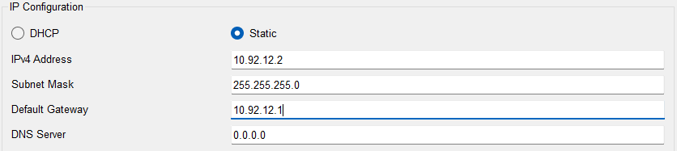

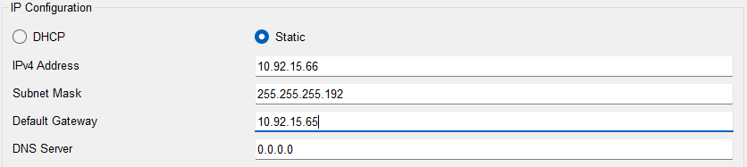

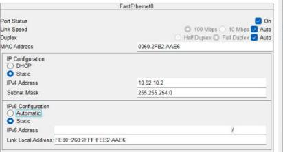

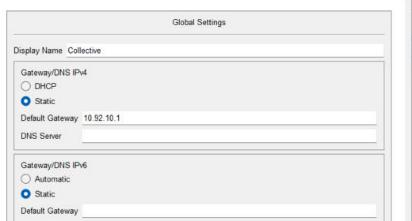

## 6. Diagnosis dan perbaikan kendala konektivitas host (`RS 232` vs `FastEthernet0`)

### Gejala awal yang ditemukan

Setelah seluruh 13 router, 13 switch, dan 25 host selesai ditempatkan dan dikonfigurasi, pengujian awal menunjukkan bahwa seluruh 13 router dan seluruh 5 host berjenis `Server-PT` (`Karl`, `Lin`, `Akashic`, `Collective`, `Eiri`) dapat di-ping dari `JJ` dengan TTL yang persis sesuai perhitungan, tetapi 12 host `PC-PT` dan `Laptop-PT` pada cabang `Switch2` dan rantai `Tachibana` (`Juri`, `Masayuki`, `Omnipresence`, `Denpa`, `Ghost`, `Lilith`, `Specter`, `Chisa`, `Hodgeson`, `Semi`, `Lain`, `Mika`) mengalami *Request timed out* dan menampilkan indikator segitiga merah pada sambungan ke switch atau router.

### Analisis akar masalah melalui pemeriksaan topologi CPT

Pemeriksaan daftar tautan fisik pada proyek CPT menggunakan antarmuka Script Engine (`MCP-Packet-Tracer`) mengungkap penyebab pastinya:

- Pada `Server-PT`, menu pilihan port saat memasang kabel hanya menampilkan `FastEthernet0` sebagai urutan pertama.
- Pada `PC-PT` dan `Laptop-PT`, menu pilihan port menampilkan `RS 232` pada baris pertama dan `FastEthernet0` pada baris kedua.
- Akibatnya, saat pemasangan kabel dilakukan menggunakan navigasi tombol panah bawah satu kali, ke-12 perangkat `PC-PT` dan `Laptop-PT` tersebut tertaut pada port serial `RS 232`, bukan pada antarmuka jaringan `FastEthernet0`. Karena port `FastEthernet0` tidak memiliki kabel, status protokol antarmuka pada host (serta port `Copland Fa0/1` yang terhubung langsung ke `Juri`) tetap `down`.

### Tindakan perbaikan

Seluruh 12 tautan yang mengarah ke port `RS 232` dihapus dan dipasang ulang ke port `FastEthernet0` dengan jenis kabel yang sesuai (Copper Cross-Over untuk `Copland Fa0/1 <-> Juri FastEthernet0`, dan Copper Straight-Through untuk 11 host lainnya yang melalui switch). Setelah waktu simulasi dipercepat (*Fast Forward Time* agar *Spanning Tree Protocol* pada switch selesai transisi ke status *forwarding*), ke-51 kabel pada kanvas berubah menjadi segitiga hijau (`up/up`):

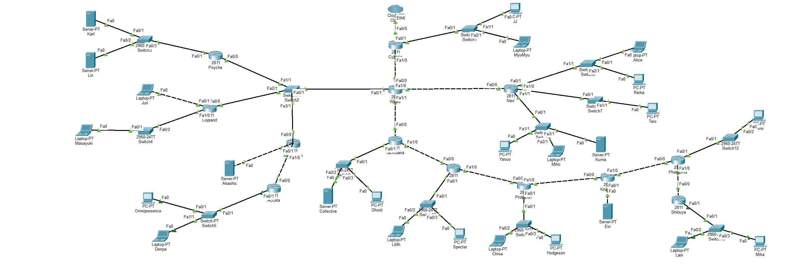

## 7. Verifikasi tabel routing, antarmuka, dan pengujian konektivitas menyeluruh

Setelah seluruh sambungan fisik berstatus `up/up`, dilakukan pengujian menyeluruh terhadap ke-13 router dan ke-25 host (rincian lengkap tabel dan keluaran CLI tersedia pada berkas [`Hasil-Pengujian-CPT.md`](./Hasil-Pengujian-CPT.md)):

1. **Pemeriksaan status antarmuka dan tabel routing (`show ip interface brief`, `show ip route`, `show cdp neighbors`)**:
   - Seluruh 36 antarmuka router yang digunakan berstatus `up / up`.
   - Seluruh 55 rute statis aktif di tabel routing tanpa celah konvergensi (*zero convergence gaps*) dan tanpa *routing loop*.

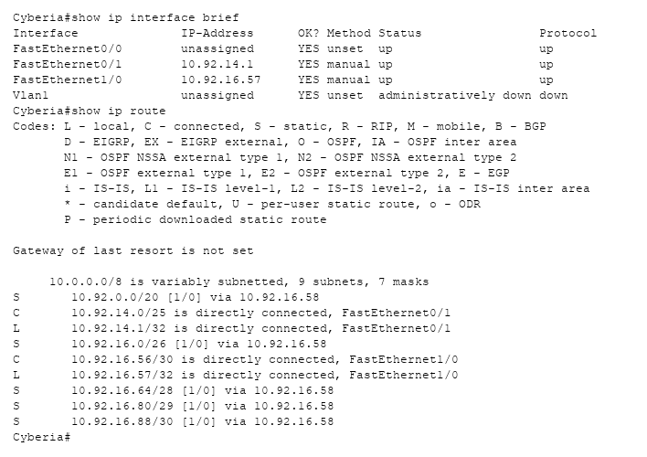

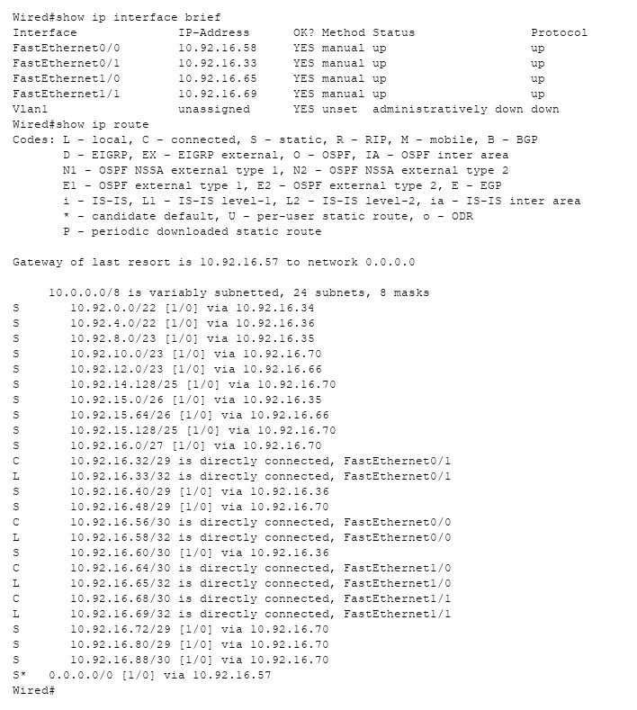

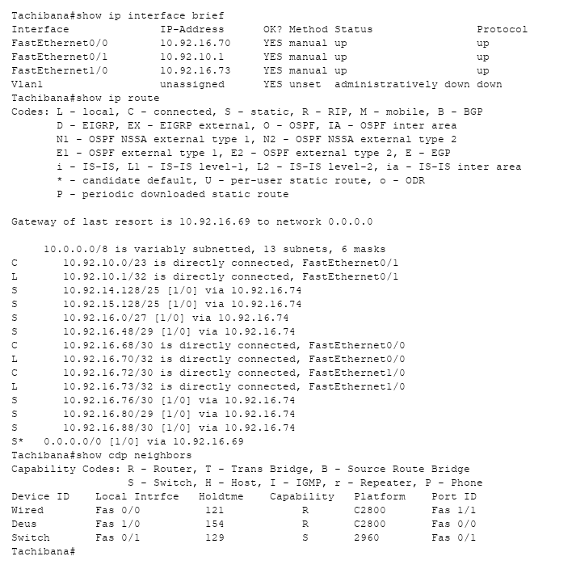

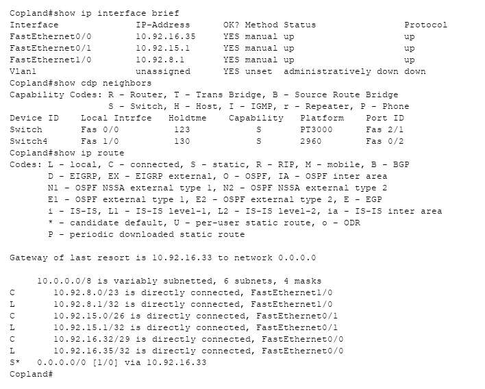

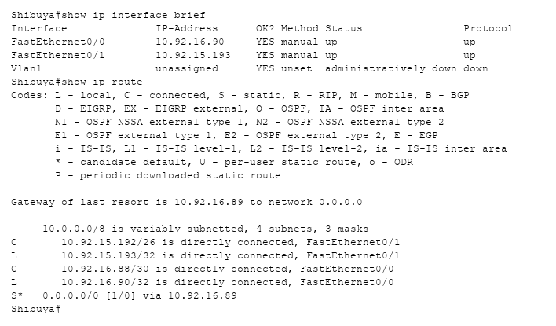

2. **Pengujian `ping` dan kesesuaian nilai TTL dari `JJ` (`10.92.14.2`)**:
   - `JJ` melakukan `ping` ke seluruh 13 router (**13/13 berhasil**, `0% loss`) dan seluruh 25 host (**25/25 berhasil**, `0% loss`).
   - Setiap nilai TTL yang teramati cocok 100% dengan rumus `TTL = 255 - jumlah router transit` (untuk balasan dari router Cisco IOS) dan `TTL = 128 - jumlah router transit` (untuk balasan dari host PC/Laptop/Server di CPT), membuktikan paket menempuh jumlah hop yang paling efisien.

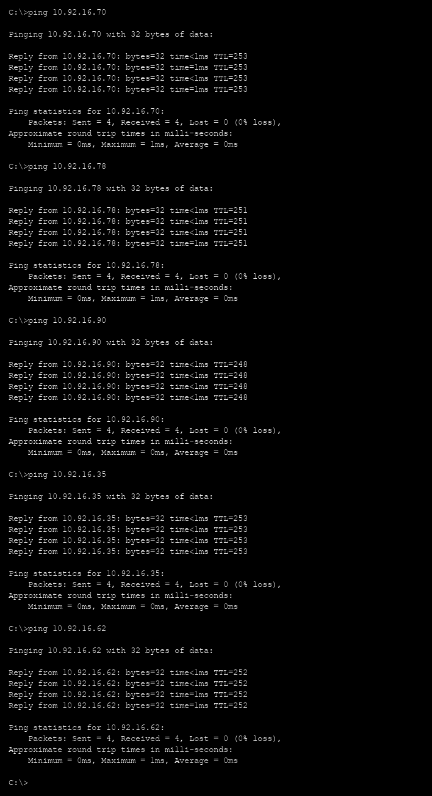

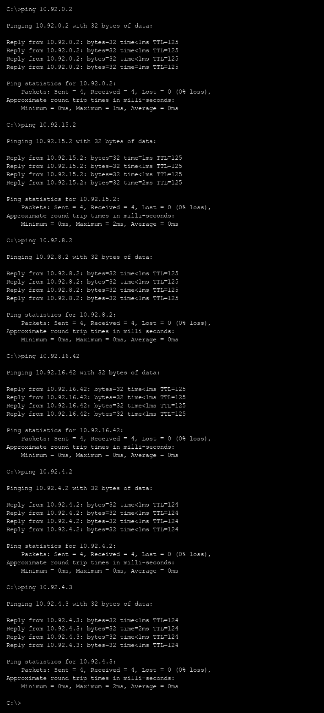

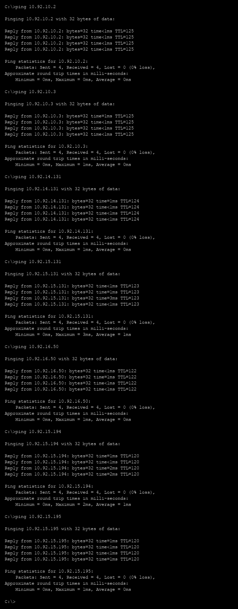

3. **Pengujian `tracert` dan konektivitas dua arah dari lapisan terdalam (`Lain`, `10.92.15.194`)**:
   - `tracert 10.92.15.194` dari `JJ` ke `Lain` menempuh tepat 9 hop (8 router: `Cyberia -> Wired -> Tachibana -> Deus -> Protocol7 -> Knights -> Phantoma -> Shibuya` ditambah host tujuan `Lain`).
   - `Lain` melakukan `ping` balik ke seluruh 25 host (**25/25 berhasil**, `0% loss`) serta `tracert` ke `JJ` (9 hop) dan ke `Omnipresence` di ujung cabang `Accela` (10 hop melewati `Shibuya -> Phantoma -> Knights -> Protocol7 -> Deus -> Tachibana -> Wired -> Schumann -> Accela -> Omnipresence`).

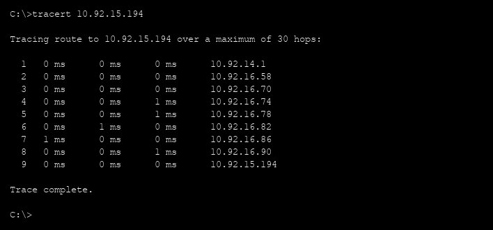

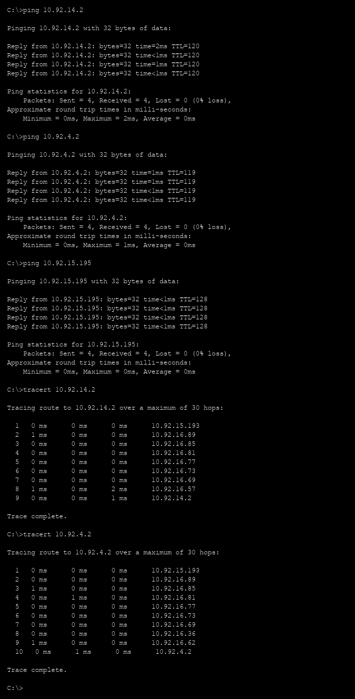

