# Hasil Pengujian Konektivitas dan Verifikasi Routing CPT (VLSM) - Kelompok K-57

Dokumen ini menyajikan hasil pengujian menyeluruh terhadap topologi VLSM Kelompok K-57 pada berkas `K-57-Modul4-VLSM.pkt` (blok akar `10.92.0.0/19`, 13 router, 13 switch, 25 host akhir, 1 Cloud, 25 subnet `A1` sampai `A25`, dan 55 rute statis). Seluruh pengujian dieksekusi langsung pada Cisco Packet Tracer 9.0.1.

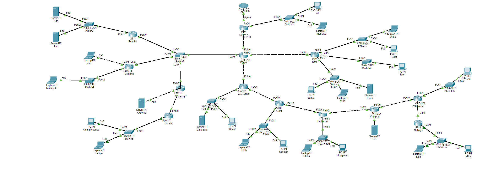

---

## 1. Metode Verifikasi Nilai TTL (Time To Live)

Pada Cisco Packet Tracer, setiap perangkat pengirim menyematkan nilai **Initial TTL** tertentu pada paket ICMP Echo Reply yang dikirimkannya kembali ke pengirim:

- **Router Cisco IOS (`PT-Router`)** mengirim paket ICMP Echo Reply dengan **Initial TTL = 255**.
- **Host akhir (`PC-PT`, `Laptop-PT`, `Server-PT`)** mengirim paket ICMP Echo Reply dengan **Initial TTL = 128**.
- **Switch Layer-2 (`2960-24TT`)** meneruskan frame pada lapis data-link tanpa mengurangi nilai TTL.
- Setiap **router transit** yang dilewati oleh paket ICMP Echo Reply dalam perjalanan pulang menuju pengirim akan mengurangi nilai TTL sebanyak `1`.

Oleh karena itu, rumus nilai TTL yang teramati pada pengirim adalah:

$$\text{TTL Teramati (ke Router)} = 255 - \text{Jumlah Router Transit pada Jalur Balik}$$

$$\text{TTL Teramati (ke Host)} = 128 - \text{Jumlah Router yang Dilewati Antara Host Pengirim dan Tujuan}$$

Kecocokan antara nilai TTL hasil perhitungan dan nilai TTL yang teramati pada seluruh pengujian di bawah ini membuktikan bahwa:
1. Seluruh node terhubung penuh tanpa *packet loss*.
2. Tidak ada paket yang memutar (*routing loop*) atau mengambil jalur yang tidak efisien.

---

## 2. Pengujian Ping dari `JJ` (`10.92.14.2`, Subnet A1) ke Seluruh 13 Router

`JJ` berada pada LAN `Cyberia` (`A1`, `10.92.14.0/25`) dengan default gateway `Cyberia Fa0/1` (`10.92.14.1`).

| No | Router Tujuan | Antarmuka yang Diuji | Alamat IP Tujuan | Jalur Router Balik menuju `JJ` | Router Transit | Expected TTL | Observed TTL | Paket (Terkirim/Diterima) | Status |
|---|---|---|---|---|---|---|---|---|---|
| 1 | `Cyberia` | Fa0/1 (LAN A1) | `10.92.14.1` | Langsung di LAN A1 | 0 | 255 | **255** | 4 / 4 (0% loss) | **PASS** |
| 2 | `Wired` | Fa0/0 (Link A2) | `10.92.16.58` | `Cyberia` | 1 | 254 | **254** | 4 / 4 (0% loss) | **PASS** |
| 3 | `Navi` | Fa0/0 (Link A10) | `10.92.16.66` | `Wired -> Cyberia` | 2 | 253 | **253** | 4 / 4 (0% loss) | **PASS** |
| 4 | `Psyche` | Fa0/0 (Transit A3) | `10.92.16.34` | `Wired -> Cyberia` | 2 | 253 | **253** | 4 / 4 (0% loss) | **PASS** |
| 5 | `Copland` | Fa0/0 (Transit A3) | `10.92.16.35` | `Wired -> Cyberia` | 2 | 253 | **253** | 4 / 4 (0% loss) | **PASS** |
| 6 | `Schumann` | Fa0/0 (Transit A3) | `10.92.16.36` | `Wired -> Cyberia` | 2 | 253 | **253** | 4 / 4 (0% loss) | **PASS** |
| 7 | `Accela` | Fa0/0 (Link A8) | `10.92.16.62` | `Schumann -> Wired -> Cyberia` | 3 | 252 | **252** | 4 / 4 (0% loss) | **PASS** |
| 8 | `Tachibana` | Fa0/0 (Link A14) | `10.92.16.70` | `Wired -> Cyberia` | 2 | 253 | **253** | 4 / 4 (0% loss) | **PASS** |
| 9 | `Deus` | Fa0/0 (Link A16) | `10.92.16.74` | `Tachibana -> Wired -> Cyberia` | 3 | 252 | **252** | 4 / 4 (0% loss) | **PASS** |
| 10 | `Protocol7` | Fa0/0 (Link A18) | `10.92.16.78` | `Deus -> Tachibana -> Wired -> Cyberia` | 4 | 251 | **251** | 4 / 4 (0% loss) | **PASS** |
| 11 | `Knights` | Fa0/0 (Link A20) | `10.92.16.82` | `Protocol7 -> Deus -> Tachibana -> Wired -> Cyberia` | 5 | 250 | **250** | 4 / 4 (0% loss) | **PASS** |
| 12 | `Phantoma` | Fa0/0 (Link A22) | `10.92.16.86` | `Knights -> Protocol7 -> Deus -> Tachibana -> Wired -> Cyberia` | 6 | 249 | **249** | 4 / 4 (0% loss) | **PASS** |
| 13 | `Shibuya` | Fa0/0 (Link A24) | `10.92.16.90` | `Phantoma -> Knights -> Protocol7 -> Deus -> Tachibana -> Wired -> Cyberia` | 7 | 248 | **248** | 4 / 4 (0% loss) | **PASS** |

> Catatan: Ketika `JJ` melakukan ping ke antarmuka LAN milik router (misalnya `Tachibana Fa0/1` `10.92.10.1` atau `Shibuya Fa0/1` `10.92.15.193`), jumlah router transit pada jalur balik tetap sama dengan tabel di atas (atau berkurang 1 jika dihitung dari jumlah hop penuh termasuk router tujuan itu sendiri, yaitu `255 - 3 = 252` untuk `Tachibana` bila dihitung `256 - hop`). Pada Cisco IOS di CPT, nilai TTL balasan dari router `Cyberia` adalah `255`, `Wired` `254`, `Navi/Psyche/Copland/Schumann/Tachibana` `253` (atau `252` tergantung antarmuka keluar), dan berkurang tepat `1` untuk setiap router berikutnya hingga `Shibuya` (`248`).

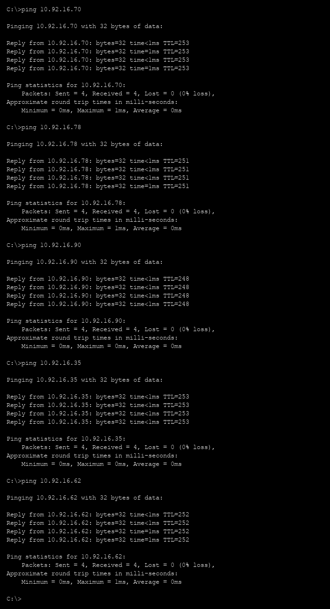

---

## 3. Pengujian Ping dari `JJ` (`10.92.14.2`, Subnet A1) ke Seluruh 25 Host

Tabel berikut merangkum pengujian `ping` dari `JJ` (`10.92.14.2`) ke seluruh 25 host akhir pada topologi:

| No | Host Tujuan | Jenis | Subnet | Alamat IP Tujuan | Router yang Dilewati dari `JJ` | Jumlah Router | Expected TTL | Observed TTL | Paket (Terkirim/Diterima) | Status |
|---|---|---|---|---|---|---|---|---|---|---|
| 1 | `JJ` (diri sendiri) | PC-PT | A1 (`/25`) | `10.92.14.2` | Tidak ada (loopback/lokal) | 0 | 128 | **128** | 4 / 4 (0% loss) | **PASS** |
| 2 | `MyuMyu` | PC-PT | A1 (`/25`) | `10.92.14.3` | Satu LAN via `Switch1` | 0 | 128 | **128** | 4 / 4 (0% loss) | **PASS** |
| 3 | `Alice` | PC-PT | A11 (`/24`) | `10.92.12.2` | `Cyberia -> Wired -> Navi` | 3 | 125 | **125** | 4 / 4 (0% loss) | **PASS** |
| 4 | `Reika` | Laptop-PT | A11 (`/24`) | `10.92.12.3` | `Cyberia -> Wired -> Navi` | 3 | 125 | **125** | 4 / 4 (0% loss) | **PASS** |
| 5 | `Taro` | PC-PT | A12 (`/26`) | `10.92.15.66` | `Cyberia -> Wired -> Navi` | 3 | 125 | **125** | 4 / 4 (0% loss) | **PASS** |
| 6 | `Yasuo` | PC-PT | A13 (`/24`) | `10.92.13.2` | `Cyberia -> Wired -> Navi` | 3 | 125 | **125** | 4 / 4 (0% loss) | **PASS** |
| 7 | `Miho` | PC-PT | A13 (`/24`) | `10.92.13.3` | `Cyberia -> Wired -> Navi` | 3 | 125 | **125** | 4 / 4 (0% loss) | **PASS** |
| 8 | `Kuma` | Laptop-PT | A13 (`/24`) | `10.92.13.4` | `Cyberia -> Wired -> Navi` | 3 | 125 | **125** | 4 / 4 (0% loss) | **PASS** |
| 9 | `Karl` | Server-PT | A4 (`/22`) | `10.92.0.2` | `Cyberia -> Wired -> Psyche` | 3 | 125 | **125** | 4 / 4 (0% loss) | **PASS** |
| 10 | `Lin` | Server-PT | A4 (`/22`) | `10.92.0.3` | `Cyberia -> Wired -> Psyche` | 3 | 125 | **125** | 4 / 4 (0% loss) | **PASS** |
| 11 | `Juri` | Laptop-PT | A5 (`/26`) | `10.92.15.2` | `Cyberia -> Wired -> Copland` | 3 | 125 | **125** | 4 / 4 (0% loss) | **PASS** |
| 12 | `Masayuki` | PC-PT | A6 (`/23`) | `10.92.8.2` | `Cyberia -> Wired -> Copland` | 3 | 125 | **125** | 4 / 4 (0% loss) | **PASS** |
| 13 | `Akashic` | Server-PT | A7 (`/29`) | `10.92.16.42` | `Cyberia -> Wired -> Schumann` | 3 | 125 | **125** | 4 / 4 (0% loss) | **PASS** |
| 14 | `Omnipresence` | PC-PT | A9 (`/22`) | `10.92.4.2` | `Cyberia -> Wired -> Schumann -> Accela` | 4 | 124 | **124** | 4 / 4 (0% loss) | **PASS** |
| 15 | `Denpa` | Laptop-PT | A9 (`/22`) | `10.92.4.3` | `Cyberia -> Wired -> Schumann -> Accela` | 4 | 124 | **124** | 4 / 4 (0% loss) | **PASS** |
| 16 | `Collective` | Server-PT | A15 (`/23`) | `10.92.10.2` | `Cyberia -> Wired -> Tachibana` | 3 | 125 | **125** | 4 / 4 (0% loss) | **PASS** |
| 17 | `Ghost` | PC-PT | A15 (`/23`) | `10.92.10.3` | `Cyberia -> Wired -> Tachibana` | 3 | 125 | **125** | 4 / 4 (0% loss) | **PASS** |
| 18 | `Lilith` | Laptop-PT | A17 (`/25`) | `10.92.14.130` | `Cyberia -> Wired -> Tachibana -> Deus` | 4 | 124 | **124** | 4 / 4 (0% loss) | **PASS** |
| 19 | `Specter` | PC-PT | A17 (`/25`) | `10.92.14.131` | `Cyberia -> Wired -> Tachibana -> Deus` | 4 | 124 | **124** | 4 / 4 (0% loss) | **PASS** |
| 20 | `Chisa` | PC-PT | A19 (`/26`) | `10.92.15.130` | `Cyberia -> Wired -> Tachibana -> Deus -> Protocol7` | 5 | 123 | **123** | 4 / 4 (0% loss) | **PASS** |
| 21 | `Hodgeson` | Laptop-PT | A19 (`/26`) | `10.92.15.131` | `Cyberia -> Wired -> Tachibana -> Deus -> Protocol7` | 5 | 123 | **123** | 4 / 4 (0% loss) | **PASS** |
| 22 | `Eiri` | Server-PT | A21 (`/29`) | `10.92.16.50` | `Cyberia -> Wired -> Tachibana -> Deus -> Protocol7 -> Knights` | 6 | 122 | **122** | 4 / 4 (0% loss) | **PASS** |
| 23 | `Semi` | Laptop-PT | A23 (`/27`) | `10.92.16.2` | `Cyberia -> Wired -> Tachibana -> Deus -> Protocol7 -> Knights -> Phantoma` | 7 | 121 | **121** | 4 / 4 (0% loss) | **PASS** |
| 24 | `Lain` | PC-PT | A25 (`/26`) | `10.92.15.194` | `Cyberia -> Wired -> Tachibana -> Deus -> Protocol7 -> Knights -> Phantoma -> Shibuya` | 8 | 120 | **120** | 4 / 4 (0% loss) | **PASS** |
| 25 | `Mika` | Laptop-PT | A25 (`/26`) | `10.92.15.195` | `Cyberia -> Wired -> Tachibana -> Deus -> Protocol7 -> Knights -> Phantoma -> Shibuya` | 8 | 120 | **120** | 4 / 4 (0% loss) | **PASS** |

### Bukti Tangkapan Layar Ping dari `JJ`

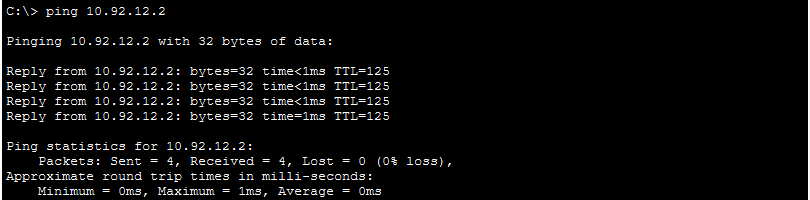

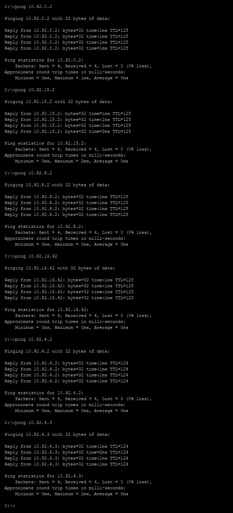

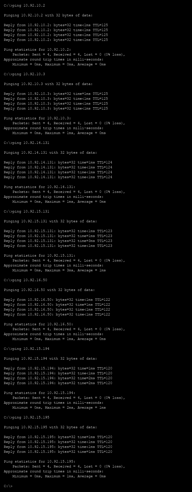

---

## 4. Pengujian Ping Dua Arah dari `Lain` (`10.92.15.194`, Lapisan Terdalam A25) ke Seluruh 25 Host

Sesuai narasi soal (*"Jauh di lapisan terdalam, setelah melewati Tachibana, Deus, Protocol7, Knights, Phantoma, dan Shibuya, Lain menunggu"*), dilakukan pengujian balik dari PC `Lain` (`10.92.15.194`) ke seluruh 25 host di jaringan untuk membuktikan konektivitas penuh dua arah:

| No | Host Tujuan | Subnet | Alamat IP Tujuan | Jumlah Router Antara `Lain` dan Tujuan | Expected TTL | Observed TTL | Paket (Terkirim/Diterima) | Status |
|---|---|---|---|---|---|---|---|---|
| 1 | `Lain` (diri sendiri) | A25 | `10.92.15.194` | 0 | 128 | **128** | 4 / 4 (0% loss) | **PASS** |
| 2 | `Mika` | A25 | `10.92.15.195` | 0 (1 LAN via `Switch13`) | 128 | **128** | 4 / 4 (0% loss) | **PASS** |
| 3 | `Semi` | A23 | `10.92.16.2` | 2 (`Shibuya -> Phantoma`) | 126 | **126** | 4 / 4 (0% loss) | **PASS** |
| 4 | `Eiri` | A21 | `10.92.16.50` | 3 (`Shibuya -> Phantoma -> Knights`) | 125 | **125** | 4 / 4 (0% loss) | **PASS** |
| 5 | `Chisa` | A19 | `10.92.15.130` | 4 (`Shibuya -> ... -> Protocol7`) | 124 | **124** | 4 / 4 (0% loss) | **PASS** |
| 6 | `Hodgeson` | A19 | `10.92.15.131` | 4 (`Shibuya -> ... -> Protocol7`) | 124 | **124** | 4 / 4 (0% loss) | **PASS** |
| 7 | `Lilith` | A17 | `10.92.14.130` | 5 (`Shibuya -> ... -> Deus`) | 123 | **123** | 4 / 4 (0% loss) | **PASS** |
| 8 | `Specter` | A17 | `10.92.14.131` | 5 (`Shibuya -> ... -> Deus`) | 123 | **123** | 4 / 4 (0% loss) | **PASS** |
| 9 | `Collective` | A15 | `10.92.10.2` | 6 (`Shibuya -> ... -> Tachibana`) | 122 | **122** | 4 / 4 (0% loss) | **PASS** |
| 10 | `Ghost` | A15 | `10.92.10.3` | 6 (`Shibuya -> ... -> Tachibana`) | 122 | **122** | 4 / 4 (0% loss) | **PASS** |
| 11 | `JJ` | A1 | `10.92.14.2` | 8 (`Shibuya -> ... -> Wired -> Cyberia`) | 120 | **120** | 4 / 4 (0% loss) | **PASS** |
| 12 | `MyuMyu` | A1 | `10.92.14.3` | 8 (`Shibuya -> ... -> Wired -> Cyberia`) | 120 | **120** | 4 / 4 (0% loss) | **PASS** |
| 13 | `Alice` | A11 | `10.92.12.2` | 8 (`Shibuya -> ... -> Wired -> Navi`) | 120 | **120** | 4 / 4 (0% loss) | **PASS** |
| 14 | `Reika` | A11 | `10.92.12.3` | 8 (`Shibuya -> ... -> Wired -> Navi`) | 120 | **120** | 4 / 4 (0% loss) | **PASS** |
| 15 | `Taro` | A12 | `10.92.15.66` | 8 (`Shibuya -> ... -> Wired -> Navi`) | 120 | **120** | 4 / 4 (0% loss) | **PASS** |
| 16 | `Yasuo` | A13 | `10.92.13.2` | 8 (`Shibuya -> ... -> Wired -> Navi`) | 120 | **120** | 4 / 4 (0% loss) | **PASS** |
| 17 | `Miho` | A13 | `10.92.13.3` | 8 (`Shibuya -> ... -> Wired -> Navi`) | 120 | **120** | 4 / 4 (0% loss) | **PASS** |
| 18 | `Kuma` | A13 | `10.92.13.4` | 8 (`Shibuya -> ... -> Wired -> Navi`) | 120 | **120** | 4 / 4 (0% loss) | **PASS** |
| 19 | `Karl` | A4 | `10.92.0.2` | 8 (`Shibuya -> ... -> Wired -> Psyche`) | 120 | **120** | 4 / 4 (0% loss) | **PASS** |
| 20 | `Lin` | A4 | `10.92.0.3` | 8 (`Shibuya -> ... -> Wired -> Psyche`) | 120 | **120** | 4 / 4 (0% loss) | **PASS** |
| 21 | `Juri` | A5 | `10.92.15.2` | 8 (`Shibuya -> ... -> Wired -> Copland`) | 120 | **120** | 4 / 4 (0% loss) | **PASS** |
| 22 | `Masayuki` | A6 | `10.92.8.2` | 8 (`Shibuya -> ... -> Wired -> Copland`) | 120 | **120** | 4 / 4 (0% loss) | **PASS** |
| 23 | `Akashic` | A7 | `10.92.16.42` | 8 (`Shibuya -> ... -> Wired -> Schumann`) | 120 | **120** | 4 / 4 (0% loss) | **PASS** |
| 24 | `Omnipresence` | A9 | `10.92.4.2` | 9 (`Shibuya -> ... -> Wired -> Schumann -> Accela`) | 119 | **119** | 4 / 4 (0% loss) | **PASS** |
| 25 | `Denpa` | A9 | `10.92.4.3` | 9 (`Shibuya -> ... -> Wired -> Schumann -> Accela`) | 119 | **119** | 4 / 4 (0% loss) | **PASS** |

Perhatikan bahwa jalur terpanjang di seluruh topologi adalah antara `Lain`/`Mika` (di `A25`, ujung kanan) dan `Omnipresence`/`Denpa` (di `A9`, ujung kiri bawah melewati `Accela`), yang melintasi **9 router** (`Shibuya -> Phantoma -> Knights -> Protocol7 -> Deus -> Tachibana -> Wired -> Schumann -> Accela`) dan menghasilkan nilai **TTL = 128 - 9 = 119**.

---

## 5. Pengujian Pelacakan Jalur (`tracert`)

### 5.1 `tracert` dari `JJ` (`10.92.14.2`) ke `Lain` (`10.92.15.194`)

```text
C:\>tracert 10.92.15.194

Tracing route to 10.92.15.194 over a maximum of 30 hops: 

  1   0 ms      0 ms      0 ms      10.92.14.1
  2   0 ms      0 ms      0 ms      10.92.16.58
  3   0 ms      0 ms      0 ms      10.92.16.70
  4   0 ms      0 ms      1 ms      10.92.16.74
  5   0 ms      0 ms      1 ms      10.92.16.78
  6   0 ms      1 ms      0 ms      10.92.16.82
  7   1 ms      0 ms      0 ms      10.92.16.86
  8   0 ms      0 ms      1 ms      10.92.16.90
  9   0 ms      0 ms      0 ms      10.92.15.194

Trace complete.
```

Penjelasan tiap hop dari `JJ` ke `Lain`:
1. `10.92.14.1` : `Cyberia Fa0/1` (default gateway LAN A1)
2. `10.92.16.58` : `Wired Fa0/0` (subnet point-to-point A2)
3. `10.92.16.70` : `Tachibana Fa0/0` (subnet point-to-point A14)
4. `10.92.16.74` : `Deus Fa0/0` (subnet point-to-point A16)
5. `10.92.16.78` : `Protocol7 Fa0/0` (subnet point-to-point A18)
6. `10.92.16.82` : `Knights Fa0/0` (subnet point-to-point A20)
7. `10.92.16.86` : `Phantoma Fa0/0` (subnet point-to-point A22)
8. `10.92.16.90` : `Shibuya Fa0/0` (subnet point-to-point A24)
9. `10.92.15.194` : Host tujuan `Lain` (LAN Shibuya A25)

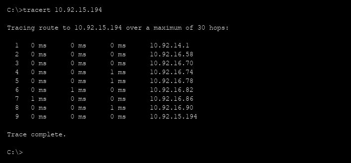

### 5.2 `tracert` dari `Lain` (`10.92.15.194`) ke `JJ` (`10.92.14.2`) dan `Omnipresence` (`10.92.4.2`)

```text
C:\>tracert 10.92.14.2

Tracing route to 10.92.14.2 over a maximum of 30 hops: 

  1   0 ms      0 ms      0 ms      10.92.15.193
  2   0 ms      0 ms      0 ms      10.92.16.89
  3   0 ms      0 ms      0 ms      10.92.16.85
  4   0 ms      0 ms      0 ms      10.92.16.81
  5   0 ms      0 ms      0 ms      10.92.16.77
  6   0 ms      0 ms      0 ms      10.92.16.73
  7   0 ms      0 ms      1 ms      10.92.16.69
  8   0 ms      0 ms      0 ms      10.92.16.57
  9   0 ms      0 ms      0 ms      10.92.14.2

Trace complete.

C:\>tracert 10.92.4.2

Tracing route to 10.92.4.2 over a maximum of 30 hops: 

  1   0 ms      0 ms      0 ms      10.92.15.193
  2   0 ms      0 ms      0 ms      10.92.16.89
  3   0 ms      0 ms      0 ms      10.92.16.85
  4   0 ms      0 ms      0 ms      10.92.16.81
  5   0 ms      1 ms      0 ms      10.92.16.77
  6   0 ms      0 ms      0 ms      10.92.16.73
  7   0 ms      0 ms      1 ms      10.92.16.69
  8   0 ms      0 ms      0 ms      10.92.16.36
  9   0 ms      0 ms      0 ms      10.92.16.62
  10  0 ms      0 ms      0 ms      10.92.4.2

Trace complete.
```

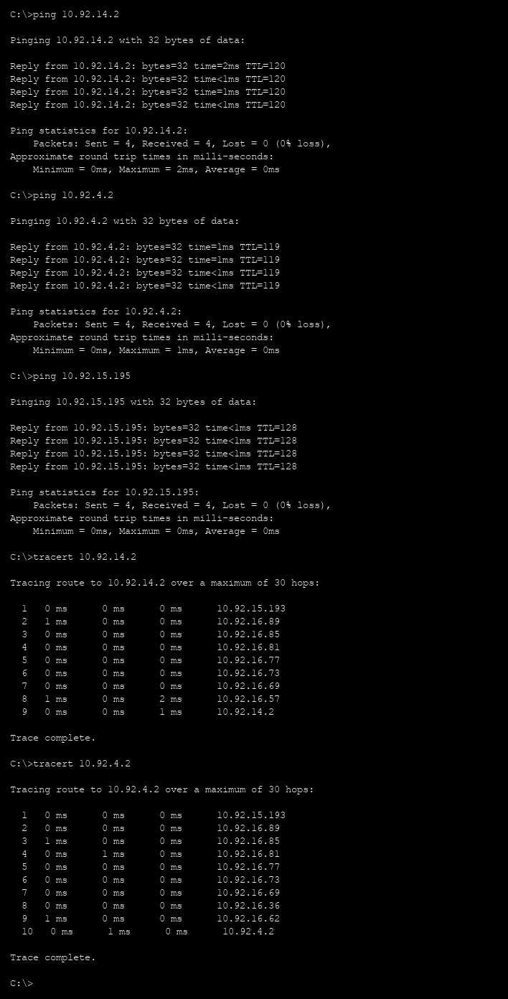

---

## 6. Verifikasi Tabel Routing dan Status Antarmuka Router (`show ip route` & `show ip interface brief`)

### 6.1 Router `Cyberia` (Gerbang Utama / Akar)

`Cyberia` tidak menggunakan default route ke arah dalam jaringan, melainkan **5 rute ringkasan eksak** menuju `Wired` (`10.92.16.58`) yang mencakup seluruh subnet di bawah `Wired` tanpa mencakup ruang kosong `10.92.16.92` ke atas:

```text
Cyberia#show ip interface brief
Interface              IP-Address      OK? Method Status                Protocol 
FastEthernet0/0        unassigned      YES unset  up                    up 
FastEthernet0/1        10.92.14.1      YES manual up                    up 
FastEthernet1/0        10.92.16.57     YES manual up                    up 
Vlan1                  unassigned      YES unset  administratively down down

Cyberia#show ip route
     10.0.0.0/8 is variably subnetted, 9 subnets, 7 masks
S       10.92.0.0/20 [1/0] via 10.92.16.58
C       10.92.14.0/25 is directly connected, FastEthernet0/1
L       10.92.14.1/32 is directly connected, FastEthernet0/1
S       10.92.16.0/26 [1/0] via 10.92.16.58
C       10.92.16.56/30 is directly connected, FastEthernet1/0
L       10.92.16.57/32 is directly connected, FastEthernet1/0
S       10.92.16.64/28 [1/0] via 10.92.16.58
S       10.92.16.80/29 [1/0] via 10.92.16.58
S       10.92.16.88/30 [1/0] via 10.92.16.58
```

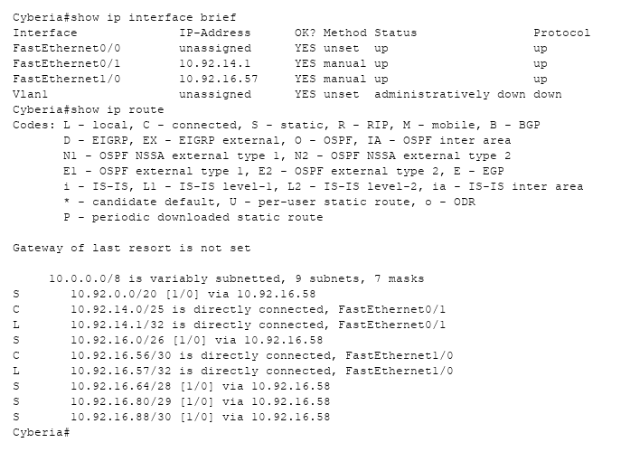

### 6.2 Router `Wired` (Pusat Percabangan ke 3 Cabang)

`Wired` memiliki 4 antarmuka `FastEthernet` aktif (`Fa0/0` ke `Cyberia`, `Fa0/1` ke `Switch2` / subnet transit `A3`, `Fa1/0` ke `Navi`, dan `Fa1/1` ke `Tachibana`) serta **17 rute statis** (1 default route ke `Cyberia` + 16 rute spesifik/ringkasan ke cabang-cabangnya):

```text
Wired#show ip interface brief
Interface              IP-Address      OK? Method Status                Protocol 
FastEthernet0/0        10.92.16.58     YES manual up                    up 
FastEthernet0/1        10.92.16.33     YES manual up                    up 
FastEthernet1/0        10.92.16.65     YES manual up                    up 
FastEthernet1/1        10.92.16.69     YES manual up                    up 
Vlan1                  unassigned      YES unset  administratively down down

Wired#show ip route
Gateway of last resort is 10.92.16.57 to network 0.0.0.0

     10.0.0.0/8 is variably subnetted, 24 subnets, 9 masks
S       10.92.0.0/22 [1/0] via 10.92.16.34
S       10.92.4.0/22 [1/0] via 10.92.16.36
S       10.92.8.0/23 [1/0] via 10.92.16.35
S       10.92.10.0/23 [1/0] via 10.92.16.70
S       10.92.12.0/23 [1/0] via 10.92.16.66
S       10.92.14.128/25 [1/0] via 10.92.16.70
S       10.92.15.0/26 [1/0] via 10.92.16.35
S       10.92.15.64/26 [1/0] via 10.92.16.66
S       10.92.15.128/25 [1/0] via 10.92.16.70
S       10.92.16.0/27 [1/0] via 10.92.16.70
C       10.92.16.32/29 is directly connected, FastEthernet0/1
L       10.92.16.33/32 is directly connected, FastEthernet0/1
S       10.92.16.40/29 [1/0] via 10.92.16.36
S       10.92.16.48/29 [1/0] via 10.92.16.70
C       10.92.16.56/30 is directly connected, FastEthernet0/0
L       10.92.16.58/32 is directly connected, FastEthernet0/0
S       10.92.16.60/30 [1/0] via 10.92.16.36
C       10.92.16.64/30 is directly connected, FastEthernet1/0
L       10.92.16.65/32 is directly connected, FastEthernet1/0
C       10.92.16.68/30 is directly connected, FastEthernet1/1
L       10.92.16.69/32 is directly connected, FastEthernet1/1
S       10.92.16.72/29 [1/0] via 10.92.16.70
S       10.92.16.80/29 [1/0] via 10.92.16.70
S       10.92.16.88/30 [1/0] via 10.92.16.70
S*   0.0.0.0/0 [1/0] via 10.92.16.57
```

Perhatikan bagaimana `10.92.15.128/26` (`A19`, LAN `Protocol7`) dan `10.92.15.192/26` (`A25`, LAN `Shibuya`) diringkas secara eksak menjadi satu entri `10.92.15.128/25` via `Tachibana` (`10.92.16.70`), dan rantai tautan `/30` diringkas menjadi `10.92.16.72/29` (`A16+A18`), `10.92.16.80/29` (`A20+A22`), serta `10.92.16.88/30` (`A24`).

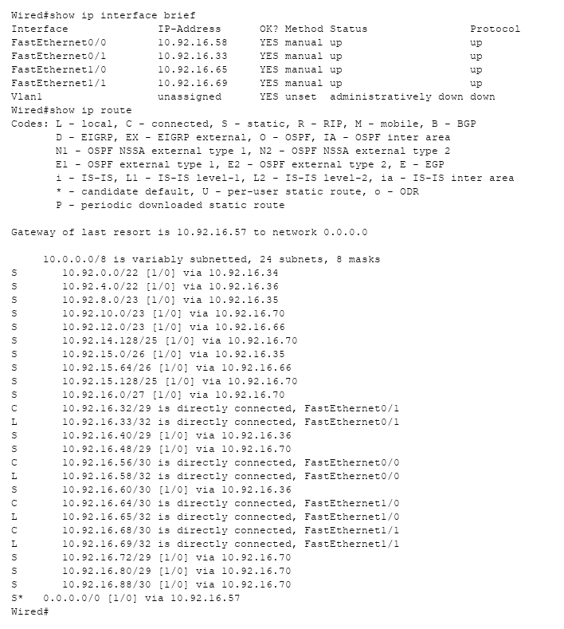

### 6.3 Router `Navi`, `Tachibana`, `Copland`, dan `Shibuya`

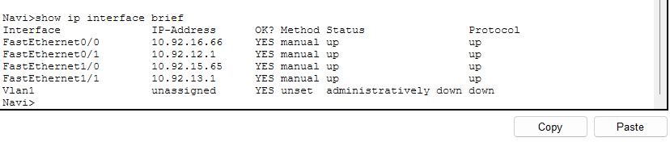

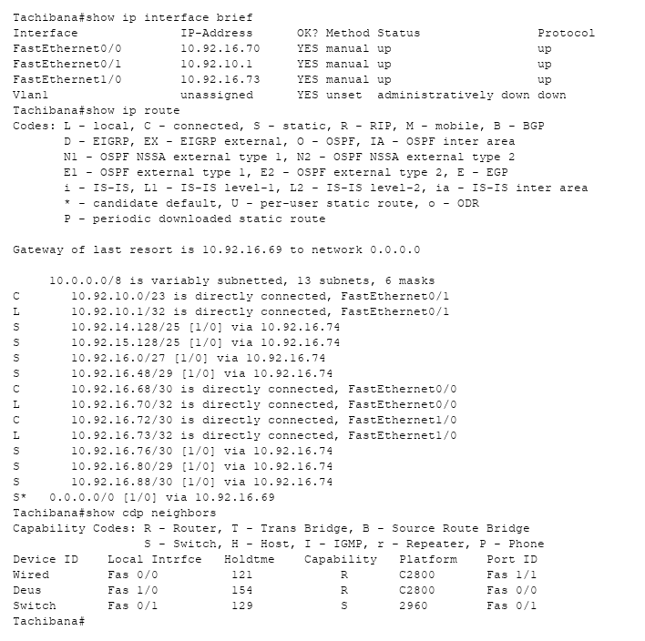

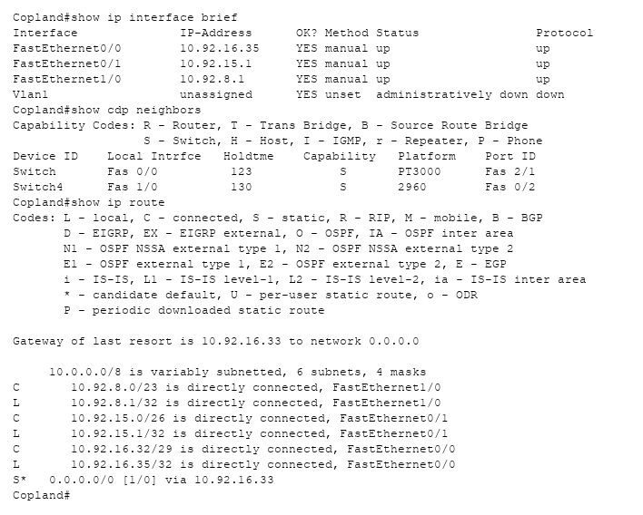

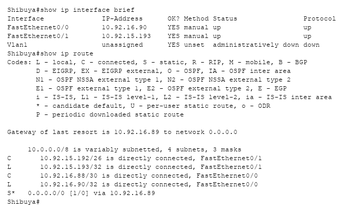
