# Jarkom-Modul-4-2026-K-57

| | |
|---|---|
| **Nama** | : Riezco Eka Bayu Witantra & Sulthan Daffa Al Hasyimi |
| **NRP** | : 5027251057 & 5027251091 |
| **Kelompok** | : K-57 |
| **Mata Kuliah** | : JarKom |

---

## Ringkasan

Praktikum Modul 4 membangun jaringan **The Wired** berdasarkan topologi dan kebutuhan host yang diberikan. Soal meminta perhitungan alamat dan routing seefisien mungkin, serta memastikan semua node terhubung dan dapat saling melakukan ping. Metode yang digunakan berbeda untuk tiap platform: **VLSM di Cisco Packet Tracer** dan **CIDR di GNS3**.

Laporan ini membagi dokumentasi menjadi dua bagian: **1. CIDR** untuk pengerjaan GNS3 dan **2. VLSM** untuk pengerjaan Cisco Packet Tracer.

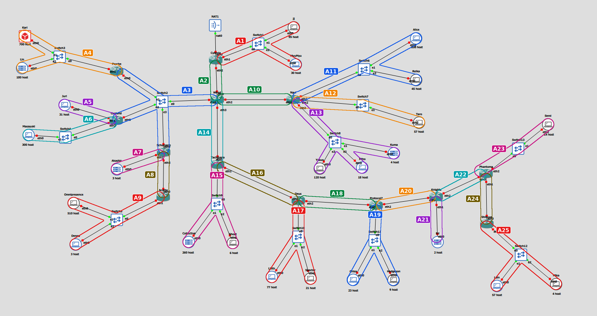

## 1. CIDR

### 1.1 Berkas Dokumentasi

| Lokasi | Isi |
|---|---|
| [`GNS3 - CIDR/script.sh-router.md`](<GNS3 - CIDR/script.sh-router.md>) | Script konfigurasi setiap router |
| [`GNS3 - CIDR/clientsh.md`](<GNS3 - CIDR/clientsh.md>) | Script IP dan gateway setiap client |
| [`GNS3 - CIDR/autostart.md`](<GNS3 - CIDR/autostart.md>) | Konfigurasi autostart |
| [`GNS3 - CIDR/cara test.md`](<GNS3 - CIDR/cara test.md>) | Checklist dan langkah pengujian |
| `Assets/GNS3/` | Gambar topologi, pembagian subnet, dan bukti pengujian |

### 1.2 Topologi dan Perencanaan Alamat

Topologi terdiri dari Cyberia sebagai router yang mengarah ke NAT, Wired sebagai router inti, dan router-router cabang. Jumlah kebutuhan host pada setiap subnet mencakup node akhir dan interface router yang terhubung ke subnet tersebut.

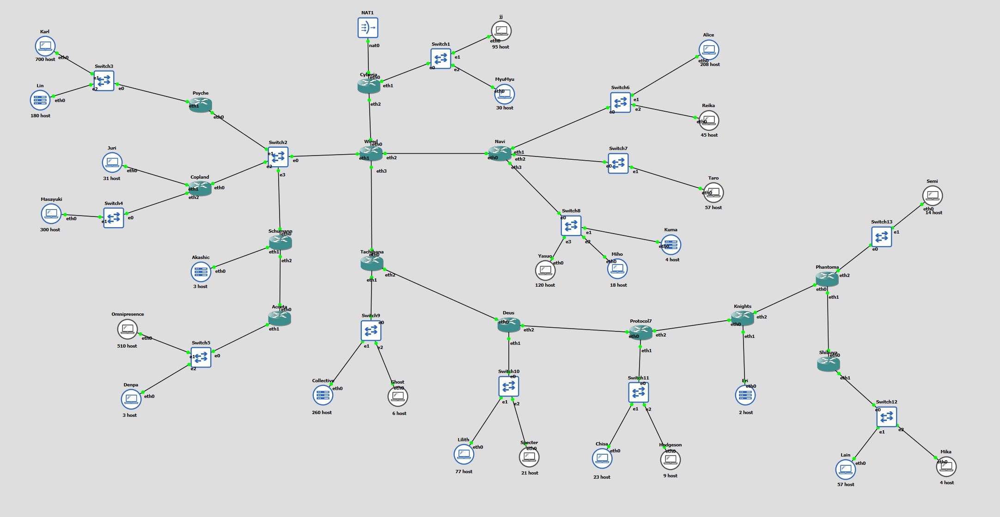

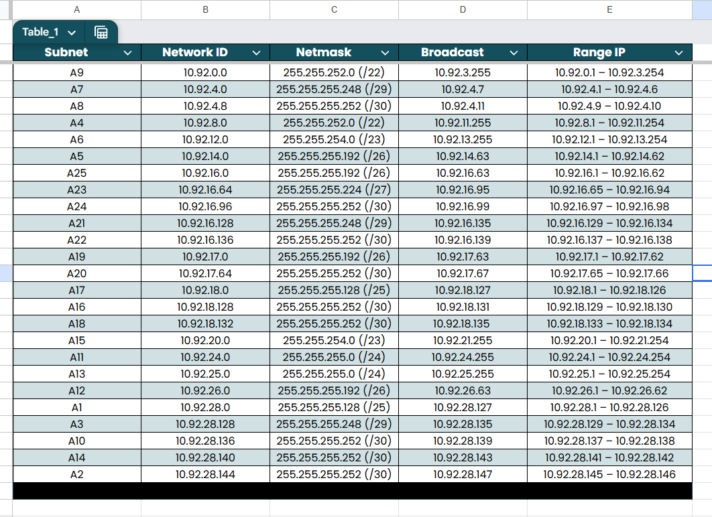

| Subnet | Network/prefix | Kebutuhan host | Gateway atau endpoint link | Node pada LAN |
|---|---|---:|---|---|
| A1 | `10.92.28.0/25` | 126 | Cyberia `10.92.28.1` | JJ, MyuMyu |
| A2 | `10.92.28.144/30` | 2 | Cyberia `.145`, Wired `.146` | Link Cyberia-Wired |
| A3 | `10.92.28.128/29` | 4 | Wired `.129`, Psyche `.130`, Copland `.131`, Schumann `.132` | Link router cabang |
| A4 | `10.92.8.0/22` | 881 | Psyche `10.92.8.1` | Karl, Lin |
| A5 | `10.92.14.0/26` | 32 | Copland `10.92.14.1` | Juri |
| A6 | `10.92.12.0/23` | 301 | Copland `10.92.12.1` | Masayuki |
| A7 | `10.92.4.0/29` | 4 | Schumann `10.92.4.1` | Akashic |
| A8 | `10.92.4.8/30` | 2 | Schumann `.9`, Aceta `.10` | Link Schumann-Aceta |
| A9 | `10.92.0.0/22` | 514 | Aceta `10.92.0.1` | Omnipresence, Denpa |
| A10 | `10.92.28.136/30` | 2 | Wired `.137`, Navi `.138` | Link Wired-Navi |
| A11 | `10.92.24.0/24` | 254 | Navi `10.92.24.1` | Alice, Reika |
| A12 | `10.92.26.0/26` | 58 | Navi `10.92.26.1` | Taro |
| A13 | `10.92.25.0/24` | 143 | Navi `10.92.25.1` | Yasuo, Miho, Kuma |
| A14 | `10.92.28.140/30` | 2 | Wired `.141`, Tachibana `.142` | Link Wired-Tachibana |
| A15 | `10.92.20.0/23` | 267 | Tachibana `10.92.20.1` | Collective, Ghost |
| A16 | `10.92.18.128/30` | 2 | Tachibana `.129`, Deus `.130` | Link Tachibana-Deus |
| A17 | `10.92.18.0/25` | 99 | Deus `10.92.18.1` | Lilith, Specter |
| A18 | `10.92.18.132/30` | 2 | Deus `.133`, Protocol7 `.134` | Link Deus-Protocol7 |
| A19 | `10.92.17.0/26` | 33 | Protocol7 `10.92.17.1` | Chisa, Hodgeson |
| A20 | `10.92.17.64/30` | 2 | Protocol7 `.65`, Knights `.66` | Link Protocol7-Knights |
| A21 | `10.92.16.128/29` | 3 | Knights `10.92.16.129` | Eri |
| A22 | `10.92.16.136/30` | 2 | Knights `.137`, Phantoma `.138` | Link Knights-Phantoma |
| A23 | `10.92.16.64/27` | 15 | Phantoma `10.92.16.65` | Semi |
| A24 | `10.92.16.96/30` | 2 | Phantoma `.97`, Shibuya `.98` | Link Phantoma-Shibuya |
| A25 | `10.92.16.0/26` | 62 | Shibuya `10.92.16.1` | Lain, Mika |

### 1.3 Perhitungan CIDR dan Routing

Prefix dipilih berdasarkan kebutuhan host pada tiap subnet. Untuk subnet LAN, jumlah alamat usable harus mencukupi host dan interface router; untuk link point-to-point digunakan subnet kecil seperti `/30`. Setelah subnet individual ditentukan, jaringan cabang diringkas menggunakan prefix bersama agar router inti tidak perlu menyimpan satu route untuk setiap LAN.


Tabel berikut merangkum prefix dari setiap tahap penggabungan. Diagram level B-I di bawah memetakan hasil penggabungan tersebut ke topologi jaringan.

| Level | Hasil penggabungan | Network/prefix | Gabungan dari |
|---|---|---|---|
| B | B1 | `10.92.16.64/26` | A23 + A24 |
| B | B2 | `10.92.16.128/28` | A21 + A22 |
| B | B3 | `10.92.17.0/25` | A19 + A20 |
| B | B4 | `10.92.18.128/29` | A16 + A18 |
| B | B5 | `10.92.24.0/23` | A11 + A13 |
| B | B6 | `10.92.4.0/28` | A7 + A8 |
| B | B7 | `10.92.12.0/22` | A6 + A5 |
| B | B8 | `10.92.28.136/29` | A10 + A14 |
| C | C1 | `10.92.16.0/25` | A25 + B1 |
| C | C2 | `10.92.18.0/24` | A17 + B4 |
| C | C3 | `10.92.28.128/28` | A3 + B8 |
| C | C4 | `10.92.0.0/21` | A9 + B6 |
| C | C5 | `10.92.8.0/21` | A4 + B7 |
| C | C6 | `10.92.24.0/22` | B5 + A12 |
| D | D1 | `10.92.16.0/24` | C1 + B2 |
| D | D2 | `10.92.28.128/27` | C3 + A2 |
| D | D3 | `10.92.0.0/20` | C4 + C5 |
| E | E1 | `10.92.16.0/23` | D1 + B3 |
| E | E2 | `10.92.28.0/24` | A1 + D2 |
| F | F1 | `10.92.16.0/22` | E1 + C2 |
| F | F2 | `10.92.24.0/21` | C6 + E2 |
| G | G1 | `10.92.16.0/21` | F1 + A15 |
| H | H1 | `10.92.16.0/20` | G1 + F2 |
| I | I1 (ROOT) | `10.92.0.0/19` | D3 + H1 |

#### Visualisasi penggabungan pada topologi

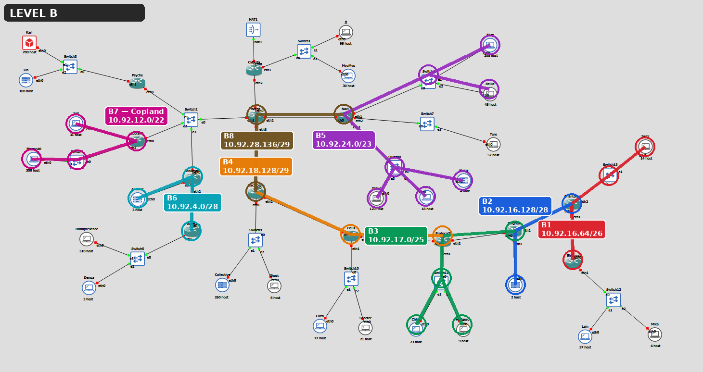

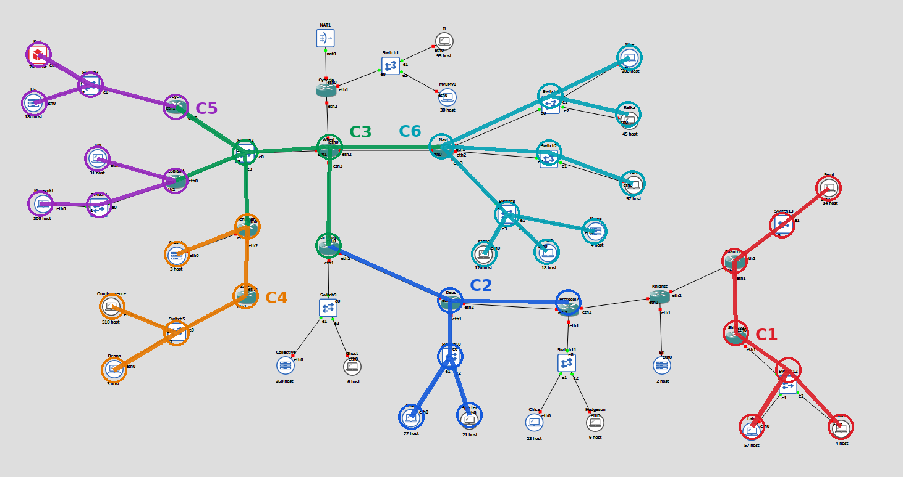

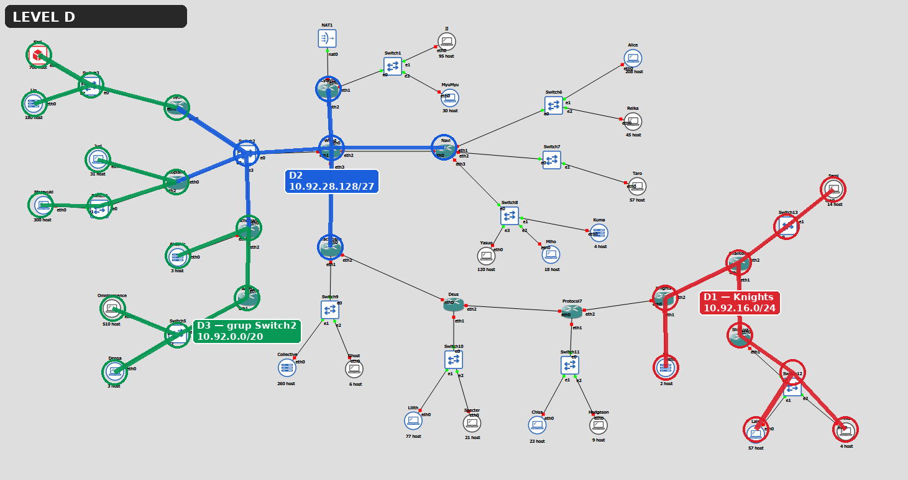

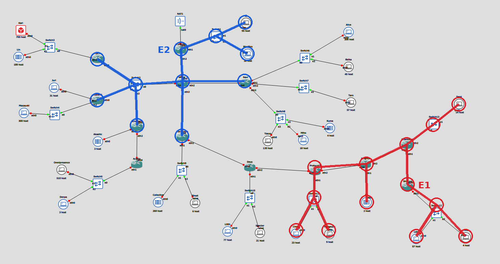

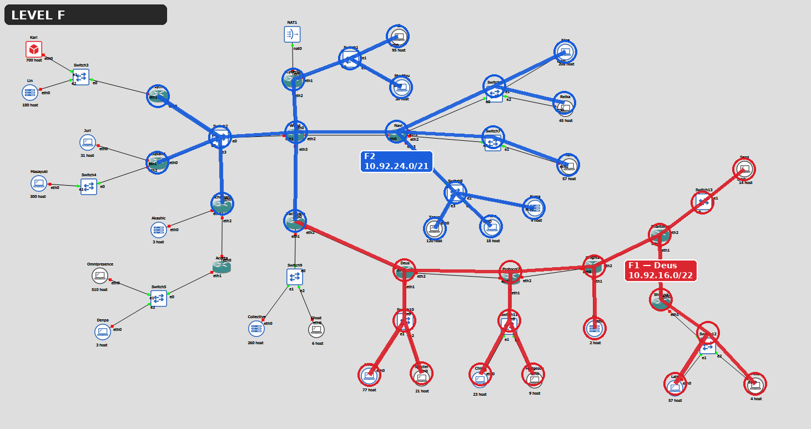

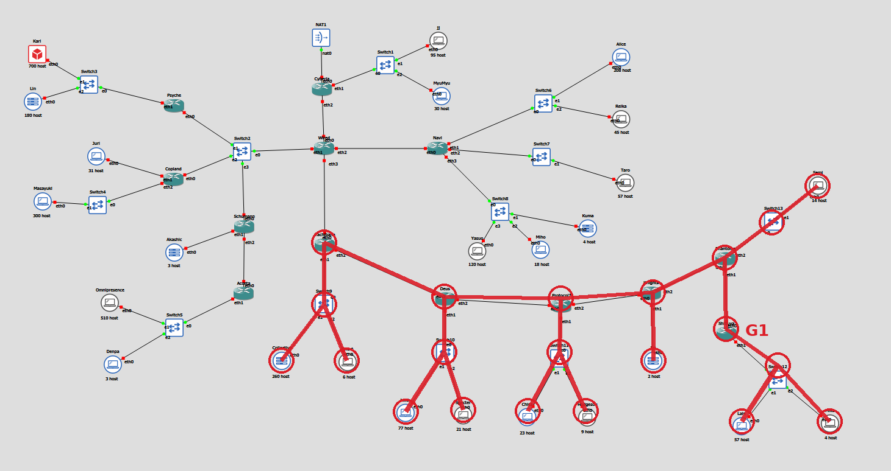

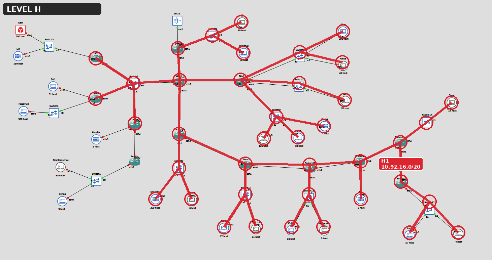

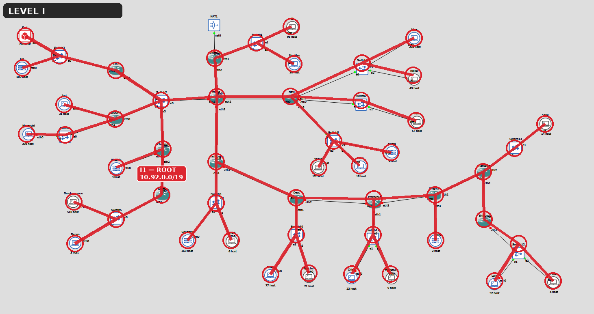

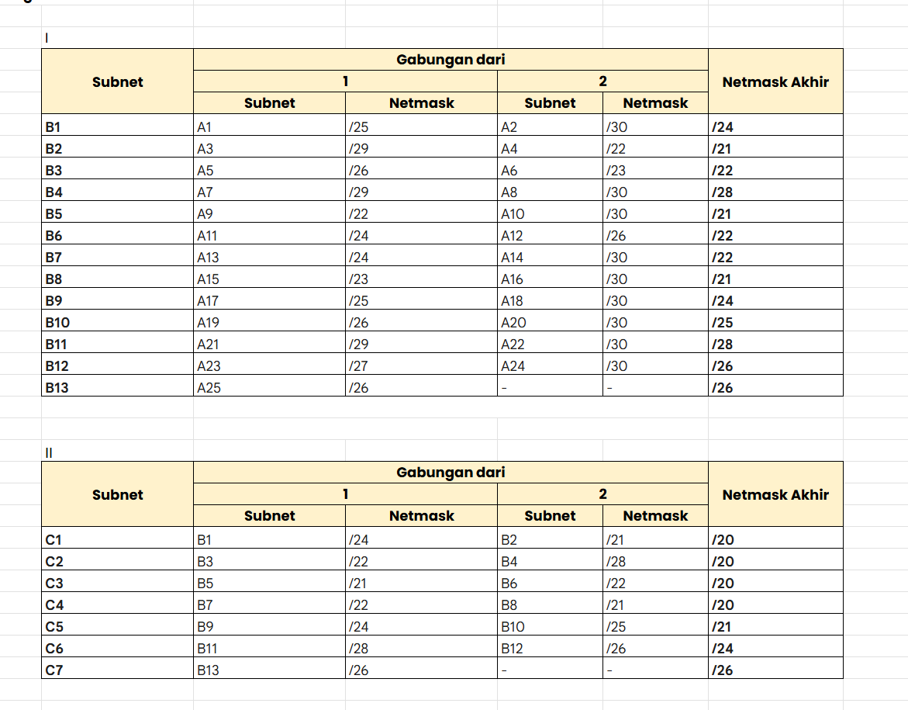

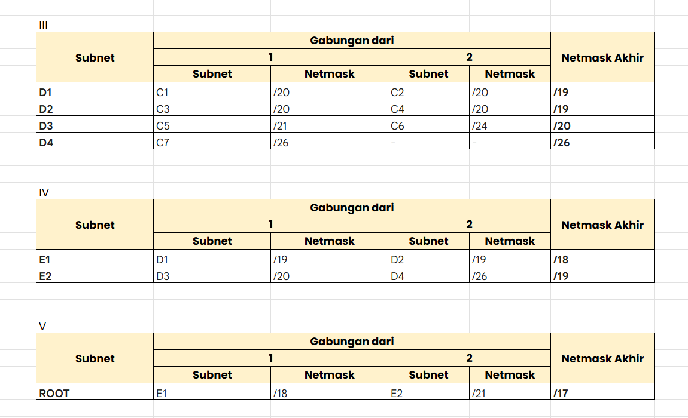

Prefix pada gambar menunjukkan penggabungan bertingkat. Tabel berikut merangkum route yang direncanakan dari hasil penggabungan:

| Router | Tujuan | Route ringkasan | Next hop |
|---|---|---|---|
| Cyberia | Seluruh jaringan internal (I1) | `10.92.0.0/19` | Wired `10.92.28.146` |
| Wired | A9 dan A7-A8 (C4) | `10.92.0.0/21` | Schumann `10.92.28.132` |
| Wired | A4 (Psyche) | `10.92.8.0/22` | Psyche `10.92.28.130` |
| Wired | A5-A6 (B7) | `10.92.12.0/22` | Copland `10.92.28.131` |
| Wired | Cabang Tachibana (G1) | `10.92.16.0/21` | Tachibana `10.92.28.142` |
| Wired | A11-A13 (C6) | `10.92.24.0/22` | Navi `10.92.28.138` |
| Schumann | A9 (Aceta) | `10.92.0.0/22` | Aceta `10.92.4.10` |
| Tachibana | Cabang Deus ke bawah (F1) | `10.92.16.0/22` | Deus `10.92.18.130` |
| Deus | Cabang Protocol7 ke bawah (E1) | `10.92.16.0/23` | Protocol7 `10.92.18.134` |
| Protocol7 | Cabang Knights ke bawah (D1) | `10.92.16.0/24` | Knights `10.92.17.66` |
| Knights | Cabang Phantoma ke bawah (C1) | `10.92.16.0/25` | Phantoma `10.92.16.138` |
| Phantoma | A25 (Shibuya) | `10.92.16.0/26` | Shibuya `10.92.16.98` |

Total hanya 12 route statis untuk seluruh jaringan. Prefix ringkasan pada rantai Tachibana bersarang (`/21` → `/22` → `/23` → `/24` → `/25` → `/26`), sehingga tiap router pada rantai tersebut cukup menyimpan satu route menuju seluruh cabang di bawahnya.

Router cabang menggunakan default route ke router induknya, sedangkan Wired menyimpan route menuju cabang. Cyberia menjadi jalur keluar ke NAT; NAT masquerade dan IP forwarding dikonfigurasi di router tersebut.

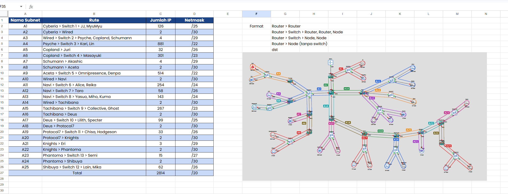

### 1.4 Implementasi Konfigurasi

Script router mengaktifkan IP forwarding, memasang alamat pada interface, menambahkan route, dan mengatur NAT pada Cyberia. Script client memasang alamat statis dan default gateway sesuai subnetnya.

1. Pada node, edit file konfigurasi dengan `nano /root/script.sh` dan masukkan script yang sesuai.
2. Beri izin eksekusi dengan `chmod +x /root/script.sh`.
3. Jalankan konfigurasi dengan `bash /root/script.sh`.
4. Konfigurasi autostart dijelaskan di [`GNS3 - CIDR/autostart.md`](<GNS3 - CIDR/autostart.md>).

Script dan alamat lengkap per node tersedia pada [konfigurasi router](<GNS3 - CIDR/script.sh-router.md>) dan [konfigurasi client](<GNS3 - CIDR/clientsh.md>). Sebelum menjalankan script kembali, periksa alamat dan route yang sudah terpasang agar tidak terjadi penambahan duplikat.

### 1.5 Pengujian

Pengujian menggunakan `ip -br addr`, `ip route`, dan `ping -c 4 <alamat-tujuan>`. Screenshot terbaru menunjukkan empat ping berhasil tanpa packet loss:

| Sumber | Tujuan | Jalur yang diuji | Hasil |
|---|---|---|---|
| JJ | MyuMyu (`10.92.28.3`) | Satu LAN (A1) | 4 paket diterima, 0% packet loss |
| Wired | Cyberia (`10.92.28.145`) | Link antar-router (A2) | 4 paket diterima, 0% packet loss |
| Schumann | Aceta (`10.92.4.10`) | Link antar-router (A8) | 4 paket diterima, 0% packet loss |
| Karl | JJ (`10.92.28.2`) | Psyche → Wired → Cyberia | 4 paket diterima, 0% packet loss |
| Karl | Mika (`10.92.16.3`) | Psyche → Wired → Tachibana → Deus → Protocol7 → Knights → Phantoma → Shibuya | 4 paket diterima, 0% packet loss |

Pengujian Karl ke Mika melewati delapan router dan seluruh rantai prefix ringkasan dari `/21` hingga `/26`, sehingga sekaligus memverifikasi bahwa summarization pada setiap tingkat bekerja.

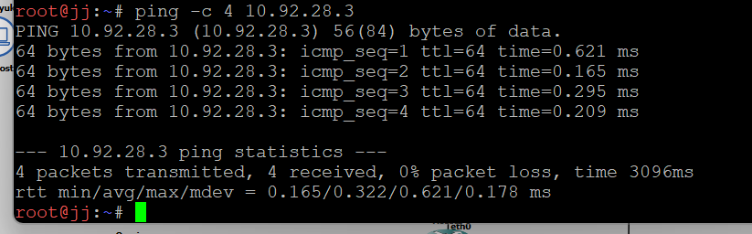

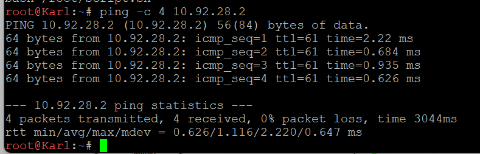

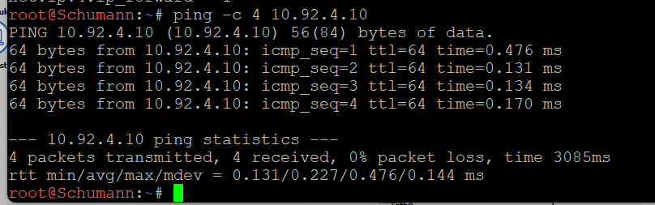

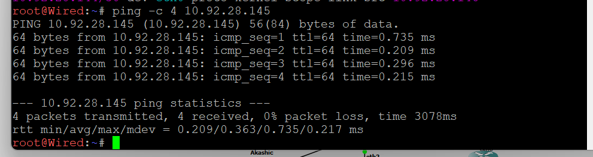

Screenshot pemeriksaan route Wired memperlihatkan alamat interface dan route ringkasan, sedangkan pemeriksaan Shibuya memperlihatkan alamat interface serta default route:

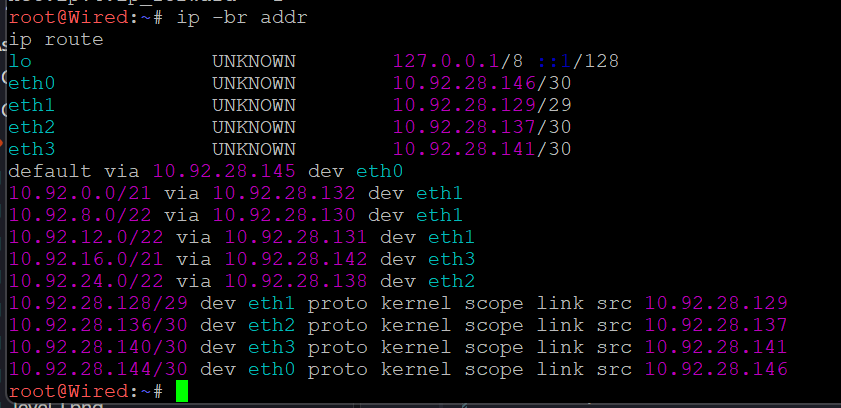

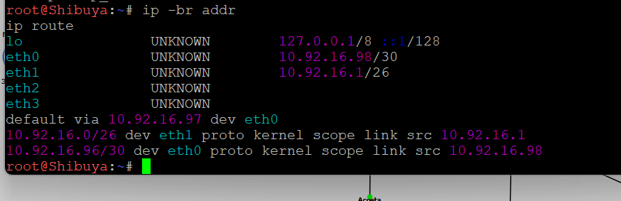

Selain ping, efisiensi routing diverifikasi dengan `ip route get` untuk memastikan paket benar-benar melewati prefix ringkasan dan bukan route per-subnet. Dijalankan pada Wired:

```bash
ip route get 10.92.16.3     # tujuan di cabang Shibuya
ip route get 10.92.20.5     # tujuan di LAN Tachibana
```

Kedua tujuan keluar melalui next hop yang sama, yaitu Tachibana `10.92.28.142`, menggunakan satu route `10.92.16.0/21`. Hal yang sama berlaku untuk cabang Schumann:

```bash
ip route get 10.92.0.5      # LAN Aceta
ip route get 10.92.4.2      # LAN Schumann
```

Keduanya keluar melalui Schumann `10.92.28.132` dengan route `10.92.0.0/21`. Ini membuktikan Wired tidak menyimpan route terpisah untuk setiap LAN di cabang tersebut.

Bukti ini mengonfirmasi konektivitas pada LAN yang sama, antar-cabang, link antar-router, serta konfigurasi pada Wired dan Shibuya. Langkah pengujian lengkap beserta checklist tersedia di [`GNS3 - CIDR/cara test.md`](<GNS3 - CIDR/cara test.md>).

### 1.6 Kesimpulan

Perancangan GNS3 membagi prefix `10.92.0.0/19` menjadi 25 subnet dengan ukuran sesuai jumlah host dan kebutuhan link antar-router. Alokasi disusun mengikuti hierarki router sehingga setiap cabang menempati satu blok utuh dan dapat diringkas menjadi satu prefix. Hasilnya, seluruh jaringan hanya membutuhkan 12 route statis: Wired menyimpan lima route menuju cabang, rantai Tachibana sampai Phantoma masing-masing cukup satu route, dan router daun hanya menggunakan default route. Cyberia menyediakan koneksi keluar melalui NAT. Seluruh node telah dikonfigurasi dan diuji saling terhubung.

## 2. VLSM

### 2.1 Berkas Dokumentasi

| Lokasi | Isi |
|---|---|
| [`CPT - VLSM/K-57-Modul4-VLSM.pkt`](<CPT - VLSM/K-57-Modul4-VLSM.pkt>) | Berkas proyek Cisco Packet Tracer 9.0.1 lengkap dan terverifikasi |
| [`CPT - VLSM/Catatan-Pengerjaan-CPT.md`](<CPT - VLSM/Catatan-Pengerjaan-CPT.md>) | Catatan langkah demi langkah pengerjaan topologi, konfigurasi router dan host, diagnosis kabel, serta bukti tiap tahap |
| [`CPT - VLSM/Hasil-Pengujian-CPT.md`](<CPT - VLSM/Hasil-Pengujian-CPT.md>) | Laporan lengkap hasil pengujian `ping`, kecocokan nilai TTL, `tracert`, dan `show ip route` |
| [`CPT - VLSM/Pembagian-IP-VLSM.xlsx`](<CPT - VLSM/Pembagian-IP-VLSM.xlsx>) | Spreadsheet perhitungan pembagian subnet VLSM (`10.92.0.0/19`) |
| `Assets/CPT/` | Gambar pohon pembagian IP VLSM, tangkapan layar topologi CPT, konfigurasi perangkat, dan bukti pengujian |

### 2.2 Topologi dan Perencanaan Alamat VLSM

Pada bagian kedua, topologi **The Wired** yang sama (13 router, 13 switch `2960-24TT`, 25 host akhir, dan 1 `Cloud-PT`, terbagi atas 25 subnet `A1` sampai `A25`) dibangun pada **Cisco Packet Tracer** dengan metode **VLSM (Variable Length Subnet Mask)** menggunakan prefix kelompok **`10.92`**.

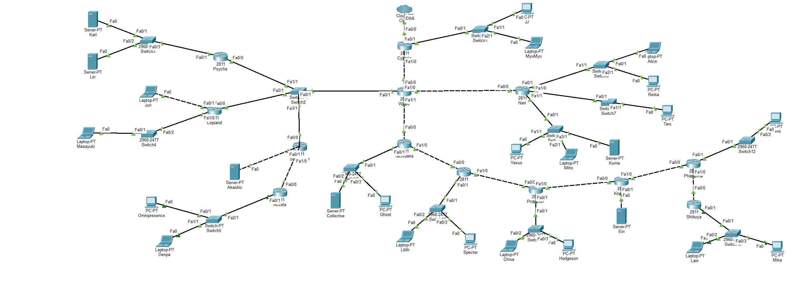

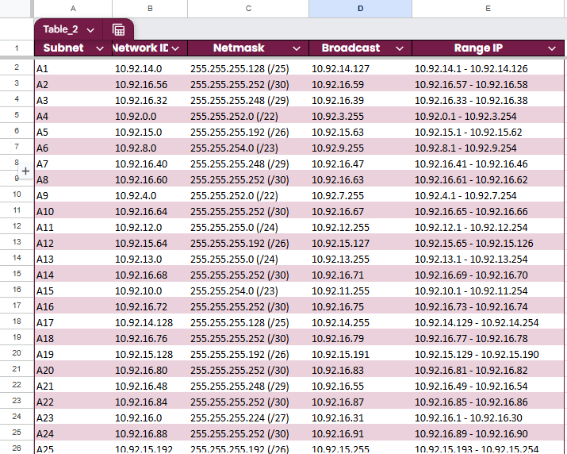

Dalam metode VLSM, seluruh 25 subnet diurutkan dari kebutuhan alamat terbesar ke terkecil, lalu dialokasikan secara berurutan dari atas ke bawah tanpa celah (*zero fragmentation*). Jumlah IP yang dibutuhkan pada tiap subnet mencakup seluruh host ditambah antarmuka router pada subnet tersebut, kemudian ditambah 2 alamat (*Network ID* dan *Broadcast*) dan dibulatkan ke pangkat dua terkecil yang mencukupi:

| Urutan Alokasi | Subnet | Segmen / Lokasi | Kebutuhan IP | Ukuran Blok (`>= IP + 2`) | Prefix | Network ID | Netmask | Broadcast | Range IP Usable | Gateway / Endpoint | Host pada LAN |
|---:|---|---|---:|---:|---|---|---|---|---|---|---|
| 1 | A4 | LAN Psyche (Switch3) | 881 | 1024 | `/22` | `10.92.0.0` | `255.255.252.0` | `10.92.3.255` | `10.92.0.1 - 10.92.3.254` | Psyche `10.92.0.1` | Karl (`.2`), Lin (`.3`) |
| 2 | A9 | LAN Accela (Switch5) | 514 | 1024 | `/22` | `10.92.4.0` | `255.255.252.0` | `10.92.7.255` | `10.92.4.1 - 10.92.7.254` | Accela `10.92.4.1` | Omnipresence (`.2`), Denpa (`.3`) |
| 3 | A6 | LAN Copland 2 (Switch4) | 301 | 512 | `/23` | `10.92.8.0` | `255.255.254.0` | `10.92.9.255` | `10.92.8.1 - 10.92.9.254` | Copland `10.92.8.1` | Masayuki (`.2`) |
| 4 | A15 | LAN Tachibana (Switch9) | 267 | 512 | `/23` | `10.92.10.0` | `255.255.254.0` | `10.92.11.255` | `10.92.10.1 - 10.92.11.254` | Tachibana `10.92.10.1` | Collective (`.2`), Ghost (`.3`) |
| 5 | A11 | LAN Navi 1 (Switch6) | 254 | 256 | `/24` | `10.92.12.0` | `255.255.255.0` | `10.92.12.255` | `10.92.12.1 - 10.92.12.254` | Navi `10.92.12.1` | Alice (`.2`), Reika (`.3`) |
| 6 | A13 | LAN Navi 3 (Switch8) | 143 | 256 | `/24` | `10.92.13.0` | `255.255.255.0` | `10.92.13.255` | `10.92.13.1 - 10.92.13.254` | Navi `10.92.13.1` | Yasuo (`.2`), Miho (`.3`), Kuma (`.4`) |
| 7 | A1 | LAN Cyberia (Switch1) | 126 | 128 | `/25` | `10.92.14.0` | `255.255.255.128` | `10.92.14.127` | `10.92.14.1 - 10.92.14.126` | Cyberia `10.92.14.1` | JJ (`.2`), MyuMyu (`.3`) |
| 8 | A17 | LAN Deus (Switch10) | 99 | 128 | `/25` | `10.92.14.128` | `255.255.255.128` | `10.92.14.255` | `10.92.14.129 - 10.92.14.254` | Deus `10.92.14.129` | Lilith (`.130`), Specter (`.131`) |
| 9 | A5 | LAN Copland 1 (tanpa switch) | 32 | 64 | `/26` | `10.92.15.0` | `255.255.255.192` | `10.92.15.63` | `10.92.15.1 - 10.92.15.62` | Copland `10.92.15.1` | Juri (`.2`) |
| 10 | A12 | LAN Navi 2 (Switch7) | 58 | 64 | `/26` | `10.92.15.64` | `255.255.255.192` | `10.92.15.127` | `10.92.15.65 - 10.92.15.126` | Navi `10.92.15.65` | Taro (`.66`) |
| 11 | A19 | LAN Protocol7 (Switch11) | 33 | 64 | `/26` | `10.92.15.128` | `255.255.255.192` | `10.92.15.191` | `10.92.15.129 - 10.92.15.190` | Protocol7 `10.92.15.129` | Chisa (`.130`), Hodgeson (`.131`) |
| 12 | A25 | LAN Shibuya (Switch13) | 62 | 64 | `/26` | `10.92.15.192` | `255.255.255.192` | `10.92.15.255` | `10.92.15.193 - 10.92.15.254` | Shibuya `10.92.15.193` | Lain (`.194`), Mika (`.195`) |
| 13 | A23 | LAN Phantoma (Switch12) | 15 | 32 | `/27` | `10.92.16.0` | `255.255.255.224` | `10.92.16.31` | `10.92.16.1 - 10.92.16.30` | Phantoma `10.92.16.1` | Semi (`.2`) |
| 14 | A3 | Transit Switch2 (4 router) | 4 | 8 | `/29` | `10.92.16.32` | `255.255.255.248` | `10.92.16.39` | `10.92.16.33 - 10.92.16.38` | Wired `.33`, Psyche `.34`, Copland `.35`, Schumann `.36` | Segmen bersama 4 router |
| 15 | A7 | LAN Schumann (tanpa switch) | 4 | 8 | `/29` | `10.92.16.40` | `255.255.255.248` | `10.92.16.47` | `10.92.16.41 - 10.92.16.46` | Schumann `10.92.16.41` | Akashic (`.42`) |
| 16 | A21 | LAN Knights (tanpa switch) | 3 | 8 | `/29` | `10.92.16.48` | `255.255.255.248` | `10.92.16.55` | `10.92.16.49 - 10.92.16.54` | Knights `10.92.16.49` | Eiri (`.50`) |
| 17 | A2 | Link Cyberia-Wired | 2 | 4 | `/30` | `10.92.16.56` | `255.255.255.252` | `10.92.16.59` | `10.92.16.57 - 10.92.16.58` | Cyberia `.57`, Wired `.58` | Link point-to-point |
| 18 | A8 | Link Schumann-Accela | 2 | 4 | `/30` | `10.92.16.60` | `255.255.255.252` | `10.92.16.63` | `10.92.16.61 - 10.92.16.62` | Schumann `.61`, Accela `.62` | Link point-to-point |
| 19 | A10 | Link Wired-Navi | 2 | 4 | `/30` | `10.92.16.64` | `255.255.255.252` | `10.92.16.67` | `10.92.16.65 - 10.92.16.66` | Wired `.65`, Navi `.66` | Link point-to-point |
| 20 | A14 | Link Wired-Tachibana | 2 | 4 | `/30` | `10.92.16.68` | `255.255.255.252` | `10.92.16.71` | `10.92.16.69 - 10.92.16.70` | Wired `.69`, Tachibana `.70` | Link point-to-point |
| 21 | A16 | Link Tachibana-Deus | 2 | 4 | `/30` | `10.92.16.72` | `255.255.255.252` | `10.92.16.75` | `10.92.16.73 - 10.92.16.74` | Tachibana `.73`, Deus `.74` | Link point-to-point |
| 22 | A18 | Link Deus-Protocol7 | 2 | 4 | `/30` | `10.92.16.76` | `255.255.255.252` | `10.92.16.79` | `10.92.16.77 - 10.92.16.78` | Deus `.77`, Protocol7 `.78` | Link point-to-point |
| 23 | A20 | Link Protocol7-Knights | 2 | 4 | `/30` | `10.92.16.80` | `255.255.255.252` | `10.92.16.83` | `10.92.16.81 - 10.92.16.82` | Protocol7 `.81`, Knights `.82` | Link point-to-point |
| 24 | A22 | Link Knights-Phantoma | 2 | 4 | `/30` | `10.92.16.84` | `255.255.255.252` | `10.92.16.87` | `10.92.16.85 - 10.92.16.86` | Knights `.85`, Phantoma `.86` | Link point-to-point |
| 25 | A24 | Link Phantoma-Shibuya | 2 | 4 | `/30` | `10.92.16.88` | `255.255.255.252` | `10.92.16.91` | `10.92.16.89 - 10.92.16.90` | Phantoma `.89`, Shibuya `.90` | Link point-to-point |

### 2.3 Perhitungan Pohon VLSM dan Summarization Rute Statis

#### Pemilihan Blok Akar (`10.92.0.0/19`)

Jumlah kebutuhan IP murni seluruh 25 subnet adalah `2814` alamat, tetapi setelah setiap subnet dibulatkan ke ukuran blok pangkat dua (`IP + 2`), total ruang blok yang dibutuhkan adalah:

$$2(1024) + 2(512) + 2(256) + 2(128) + 4(64) + 1(32) + 3(8) + 9(4) = 4188 \text{ alamat}$$

Karena satu blok `/20` hanya memuat `4096` alamat (`4188 > 4096`), blok induk terkecil yang dapat menampung seluruh 25 subnet adalah **`10.92.0.0/19`** (`8192` alamat). Dua belas subnet terbesar (`A4, A9, A6, A15, A11, A13, A1, A17, A5, A12, A19, A25`) tepat menghabiskan paruh pertama `10.92.0.0/20` (`4096` alamat: `10.92.0.0` sampai `10.92.15.255`), sedangkan 13 subnet berikutnya (`A23` sampai `A24`, total `92` alamat) menempati `10.92.16.0` sampai `10.92.16.91`.

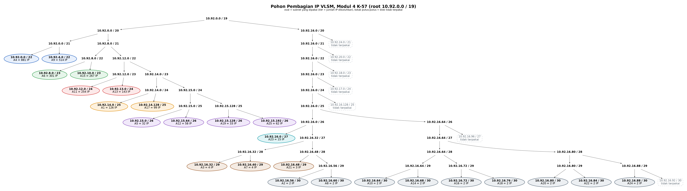

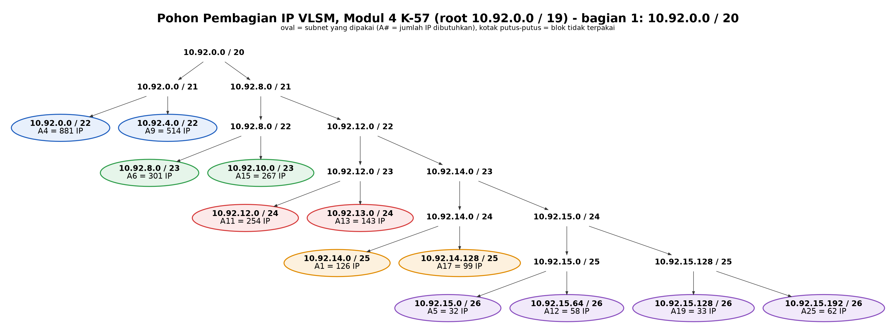

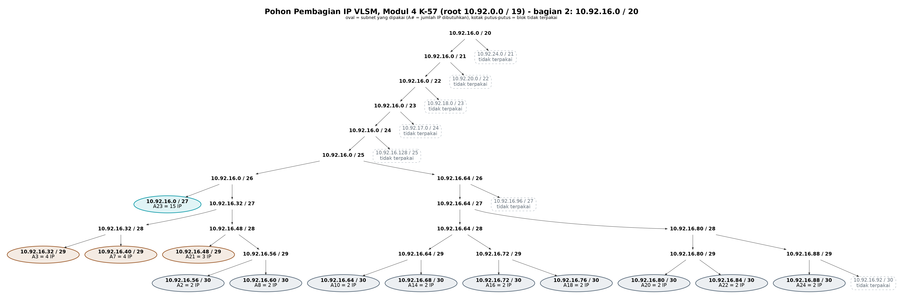

#### Perancangan Rute Statis dan Summarization (55 Rute Statis)

Karena VLSM mengurutkan subnet berdasarkan ukuran blok (bukan berdasarkan cabang lokasi seperti pada CIDR), penggabungan rute (*route summarization*) harus dilakukan secara **eksak** hanya pada blok-blok bersebelahan yang menuju next-hop yang sama, dikombinasikan dengan **default route (`0.0.0.0/0`)** ke arah router induk:

1. **Default Route ke Induk**: Semua router selain `Cyberia` memiliki satu default route `0.0.0.0/0` ke router di atasnya. Dengan demikian, lima router daun (`Psyche`, `Copland`, `Accela`, `Navi`, `Shibuya`) masing-masing hanya memerlukan **1 rute statis**.
2. **Summarization Eksak ke Cabang Bawah**:
   - Pada `Navi`: subnet `A11` (`10.92.12.0/24`) dan `A13` (`10.92.13.0/24`) diringkas oleh `Wired` menjadi satu rute **`10.92.12.0/23`** via `10.92.16.66`.
   - Pada rantai `Tachibana`: subnet `A19` (`10.92.15.128/26`, LAN `Protocol7`) dan `A25` (`10.92.15.192/26`, LAN `Shibuya`) diringkas oleh `Wired`, `Tachibana`, dan `Deus` menjadi satu rute **`10.92.15.128/25`**. Selain itu, pasangan link `/30` yang berdampingan diringkas menjadi **`10.92.16.72/29`** (`A16 + A18`) dan **`10.92.16.80/29`** (`A20 + A22`).
3. **Pencegahan Routing Loop di `Cyberia`**: `Cyberia` adalah akar dan tidak memasang default route ke arah `Wired`, melainkan **5 rute ringkasan eksak** (`10.92.0.0/20`, `10.92.16.0/26`, `10.92.16.64/28`, `10.92.16.80/29`, `10.92.16.88/30` via `10.92.16.58`). Hasilnya, paket menuju alamat yang tidak terpakai (`10.92.16.92` ke atas) langsung di-*drop* dan tidak memantul antara `Cyberia` dan `Wired`.

| Router | Jumlah Rute Statis | Ringkasan Rute Statis yang Terpasang |
|---|---:|---|
| `Cyberia` | 5 | `10.92.0.0/20`, `10.92.16.0/26`, `10.92.16.64/28`, `10.92.16.80/29`, `10.92.16.88/30` via `10.92.16.58` (`Wired`) |
| `Wired` | 17 | Default `0.0.0.0/0` via `10.92.16.57` (`Cyberia`); 1 rute ke `Psyche` (`10.92.0.0/22`); 2 rute ke `Copland` (`10.92.8.0/23`, `10.92.15.0/26`); 3 rute ke `Schumann` (`10.92.4.0/22`, `10.92.16.40/29`, `10.92.16.60/30`); 2 rute ke `Navi` (`10.92.12.0/23`, `10.92.15.64/26`); 8 rute ke `Tachibana` (`10.92.10.0/23`, `10.92.14.128/25`, `10.92.15.128/25`, `10.92.16.0/27`, `10.92.16.48/29`, `10.92.16.72/29`, `10.92.16.80/29`, `10.92.16.88/30`) |
| `Tachibana` | 8 | Default `0.0.0.0/0` via `10.92.16.69` (`Wired`) + 7 rute ke `Deus` (`10.92.16.74`) |
| `Deus` | 6 | Default `0.0.0.0/0` via `10.92.16.73` (`Tachibana`) + 5 rute ke `Protocol7` (`10.92.16.78`) |
| `Protocol7` | 6 | Default `0.0.0.0/0` via `10.92.16.77` (`Deus`) + 5 rute ke `Knights` (`10.92.16.82`) |
| `Knights` | 4 | Default `0.0.0.0/0` via `10.92.16.81` (`Protocol7`) + 3 rute ke `Phantoma` (`10.92.16.86`) |
| `Phantoma` | 2 | Default `0.0.0.0/0` via `10.92.16.85` (`Knights`) + 1 rute `10.92.15.192/26` ke `Shibuya` (`10.92.16.90`) |
| `Schumann` | 2 | Default `0.0.0.0/0` via `10.92.16.33` (`Wired`) + 1 rute `10.92.4.0/22` ke `Accela` (`10.92.16.62`) |
| `Psyche`, `Copland`, `Accela`, `Navi`, `Shibuya` | 5 (masing-masing 1) | Default `0.0.0.0/0` ke router induk masing-masing |
| **Total** | **55** | **Bebas routing loop dan mencakup 100% subnet A1-A25** |

### 2.4 Implementasi Konfigurasi di Cisco Packet Tracer

1. **Penyiapan Modul FastEthernet pada Router (`PT-Router`)**: Modul serial bawaan dilepas saat daya router mati, lalu diganti dengan modul `NM-1FE-TX` sehingga `Wired` dan `Navi` memiliki 4 port `FastEthernet` (`Fa0/0`, `Fa0/1`, `Fa1/0`, `Fa1/1`), router 3-antarmuka memiliki 3 port (`Fa0/0`, `Fa0/1`, `Fa1/0`), dan router 2-antarmuka memiliki 2 port (`Fa0/0`, `Fa0/1`).
2. **Pengkabelan (51 Kabel)**:
   - **39 kabel Copper Straight-Through** menghubungkan `Router <-> Switch`, `Switch <-> Host`, dan `Cloud <-> Cyberia`.
   - **12 kabel Copper Cross-Over** menghubungkan 9 tautan langsung `Router <-> Router` serta 3 tautan langsung `Router <-> Host` tanpa switch (`Copland-Juri`, `Schumann-Akashic`, `Knights-Eiri`).
   - Seluruh host dipastikan tertaut pada port **`FastEthernet0`** (bukan port serial `RS 232` yang muncul di baris pertama menu port PC/Laptop pada CPT), sehingga ke-51 tautan berstatus hijau (`up/up`).
3. **Konfigurasi CLI Router dan IPv4 Host**: Setiap router dikonfigurasi melalui tab CLI dan disimpan ke NVRAM (`write memory`), sedangkan ke-25 host diberi IP statis, netmask, dan default gateway sesuai tabel VLSM. Rincian lengkap proses pengerjaan dan bukti tangkapan layar tiap perangkat tersedia pada [`CPT - VLSM/Catatan-Pengerjaan-CPT.md`](<CPT - VLSM/Catatan-Pengerjaan-CPT.md>).

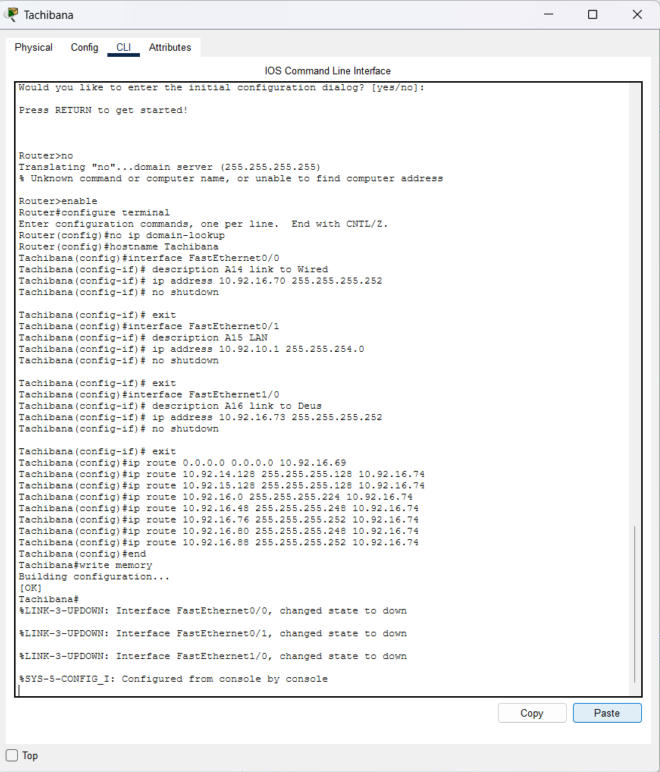

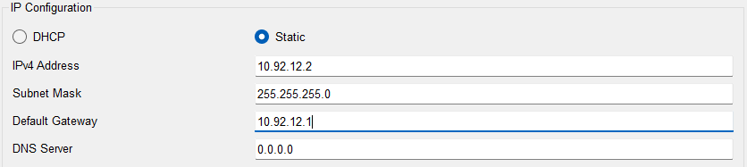

### 2.5 Pengujian Konektivitas, TTL, dan Traceroute

Pengujian penuh dilakukan dari `JJ` (`10.92.14.2`, LAN `Cyberia` A1) dan dari `Lain` (`10.92.15.194`, LAN `Shibuya` A25 di lapisan terdalam) ke seluruh perangkat pada topologi. Laporan lengkap beserta seluruh tabel tersedia pada [`CPT - VLSM/Hasil-Pengujian-CPT.md`](<CPT - VLSM/Hasil-Pengujian-CPT.md>).

#### 1. Verifikasi Tabel Routing dan Antarmuka Router

Pemeriksaan `show ip interface brief`, `show ip route`, dan `show cdp neighbors` mengonfirmasi bahwa seluruh 36 port router yang digunakan berstatus `up/up` dan seluruh 55 rute statis terpasang dengan benar:

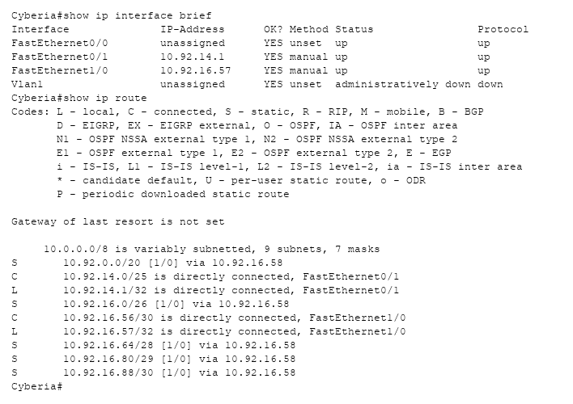

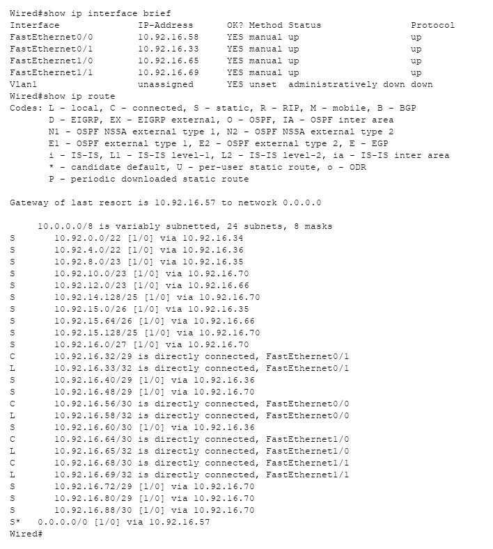

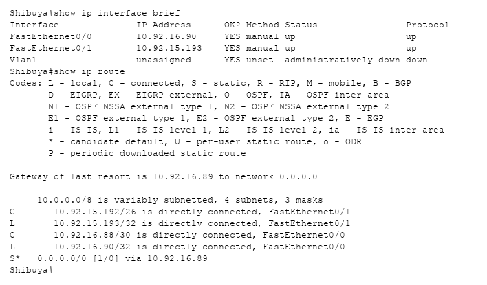

#### 2. Pengujian Ping dan Verifikasi Nilai TTL (`25/25` Host & `13/13` Router Lulus 100%)

Pada CPT, router Cisco mengirim balasan ICMP dengan **Initial TTL = 255** dan host PC/Laptop/Server mengirim balasan dengan **Initial TTL = 128**. Setiap router transit yang dilalui mengurangi TTL sebanyak `1`. Seluruh pengujian `ping` dari `JJ` dan `Lain` berhasil dengan **0% packet loss** dan nilai TTL yang 100% cocok dengan jumlah hop router:

| Pengirim | Tujuan | Subnet Tujuan | Jalur Router yang Dilewati | Jumlah Router | Expected TTL | Observed TTL | Hasil |
|---|---|---|---|---:|---:|---:|---|
| `JJ` (`10.92.14.2`) | `MyuMyu` (`10.92.14.3`) | A1 (`/25`) | Satu LAN via `Switch1` | 0 | 128 | **128** | 4/4 diterima (0% loss) |
| `JJ` (`10.92.14.2`) | `Alice` (`10.92.12.2`), `Taro` (`10.92.15.66`), `Yasuo` (`10.92.13.2`) | A11, A12, A13 | `Cyberia -> Wired -> Navi` | 3 | 125 | **125** | 4/4 diterima (0% loss) |
| `JJ` (`10.92.14.2`) | `Karl` (`10.92.0.2`), `Juri` (`10.92.15.2`), `Masayuki` (`10.92.8.2`), `Akashic` (`10.92.16.42`) | A4, A5, A6, A7 | `Cyberia -> Wired -> Psyche / Copland / Schumann` | 3 | 125 | **125** | 4/4 diterima (0% loss) |
| `JJ` (`10.92.14.2`) | `Omnipresence` (`10.92.4.2`), `Denpa` (`10.92.4.3`) | A9 (`/22`) | `Cyberia -> Wired -> Schumann -> Accela` | 4 | 124 | **124** | 4/4 diterima (0% loss) |
| `JJ` (`10.92.14.2`) | `Collective` (`10.92.10.2`), `Ghost` (`10.92.10.3`) | A15 (`/23`) | `Cyberia -> Wired -> Tachibana` | 3 | 125 | **125** | 4/4 diterima (0% loss) |
| `JJ` (`10.92.14.2`) | `Lilith` (`10.92.14.130`), `Specter` (`10.92.14.131`) | A17 (`/25`) | `Cyberia -> Wired -> Tachibana -> Deus` | 4 | 124 | **124** | 4/4 diterima (0% loss) |
| `JJ` (`10.92.14.2`) | `Chisa` (`10.92.15.130`), `Hodgeson` (`10.92.15.131`) | A19 (`/26`) | `Cyberia -> ... -> Protocol7` | 5 | 123 | **123** | 4/4 diterima (0% loss) |
| `JJ` (`10.92.14.2`) | `Eiri` (`10.92.16.50`) | A21 (`/29`) | `Cyberia -> ... -> Knights` | 6 | 122 | **122** | 4/4 diterima (0% loss) |
| `JJ` (`10.92.14.2`) | `Semi` (`10.92.16.2`) | A23 (`/27`) | `Cyberia -> ... -> Phantoma` | 7 | 121 | **121** | 4/4 diterima (0% loss) |
| `JJ` (`10.92.14.2`) | `Lain` (`10.92.15.194`), `Mika` (`10.92.15.195`) | A25 (`/26`) | `Cyberia -> Wired -> Tachibana -> Deus -> Protocol7 -> Knights -> Phantoma -> Shibuya` | 8 | 120 | **120** | 4/4 diterima (0% loss) |
| `Lain` (`10.92.15.194`) | `Omnipresence` (`10.92.4.2`), `Denpa` (`10.92.4.3`) | A9 (`/22`) | `Shibuya -> Phantoma -> Knights -> Protocol7 -> Deus -> Tachibana -> Wired -> Schumann -> Accela` | 9 | 119 | **119** | 4/4 diterima (0% loss) |

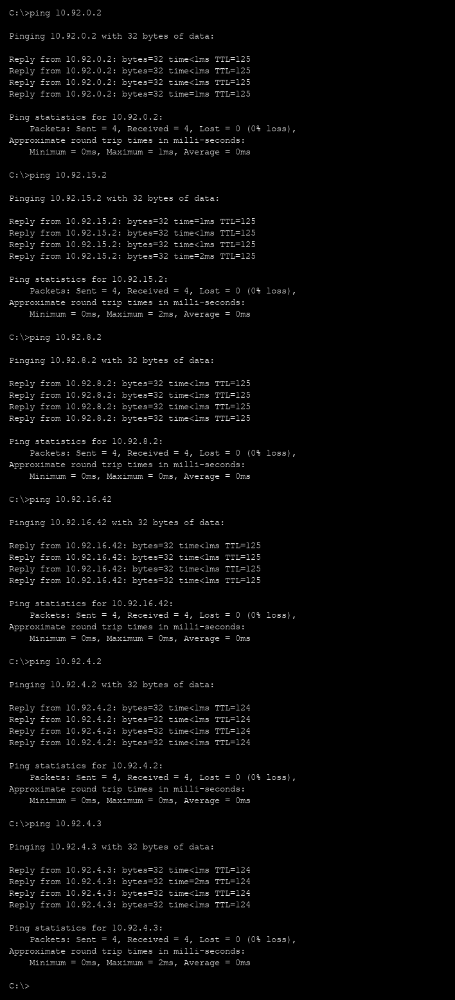

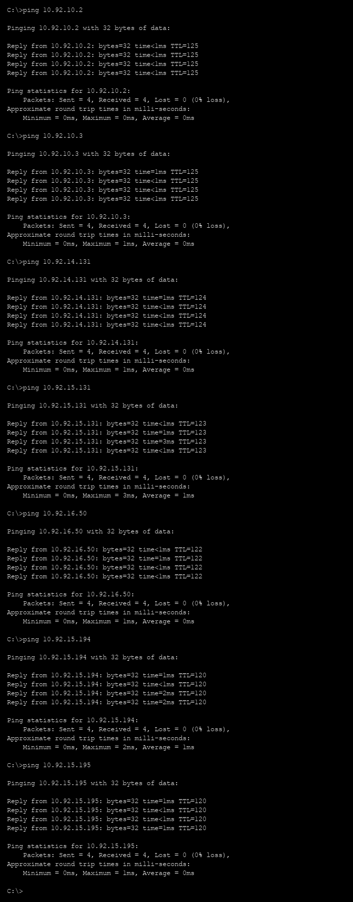

#### 3. Pelacakan Jalur (`tracert`)

Pengujian `tracert` dari `JJ` ke `Lain` (9 hop) serta dari `Lain` ke `JJ` (9 hop) dan ke `Omnipresence` (10 hop) mengonfirmasi bahwa paket menempuh jalur terpendek sesuai desain rute statis:

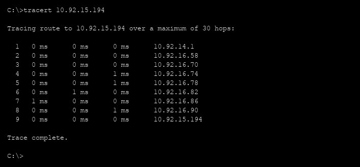

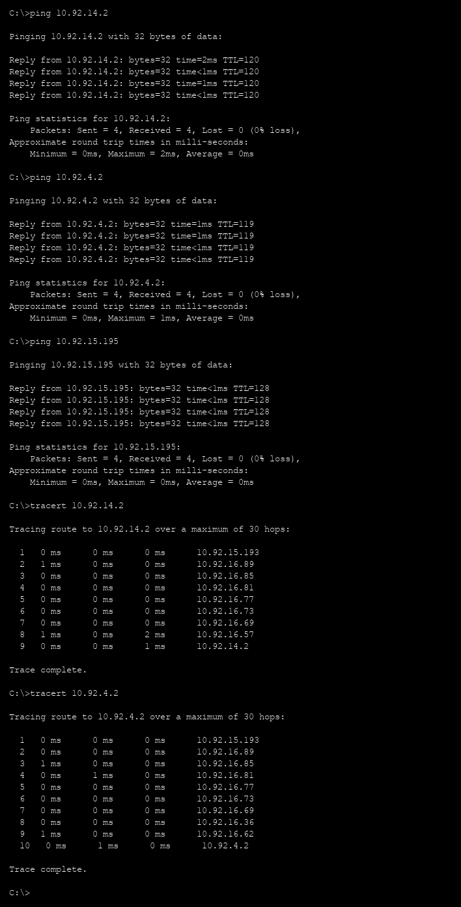

### 2.6 Kesimpulan

Perancangan VLSM pada Cisco Packet Tracer berhasil membagi blok akar `10.92.0.0/19` ke dalam 25 subnet (`A1` sampai `A25`) secara padat dari `10.92.0.0` hingga `10.92.16.91` (`4188` alamat blok) sesuai kebutuhan host dan antarmuka router tanpa celah fragmentasi di tengah ruang alamat. Dengan mengombinasikan default route ke arah induk dan *exact route summarization* ke arah cabang sebanyak total 55 rute statis, seluruh 13 router dan 25 host akhir terhubung 100% dua arah tanpa *routing loop*, dibuktikan melalui pengujian `ping` menyeluruh (kecocokan nilai TTL dari `128` hingga `119`) serta `tracert` lintas cabang terjauh.
