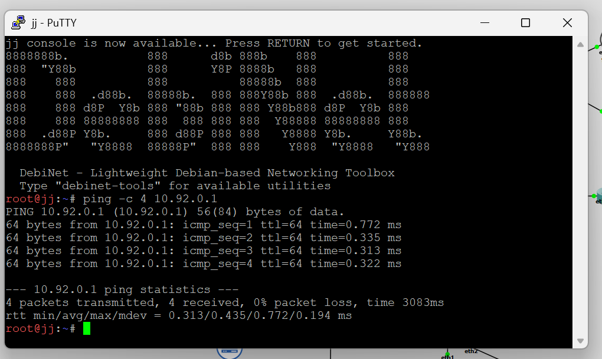
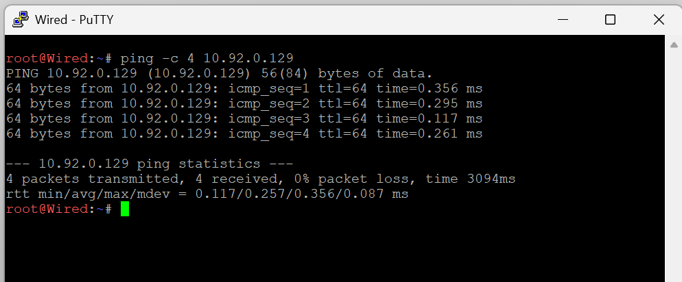
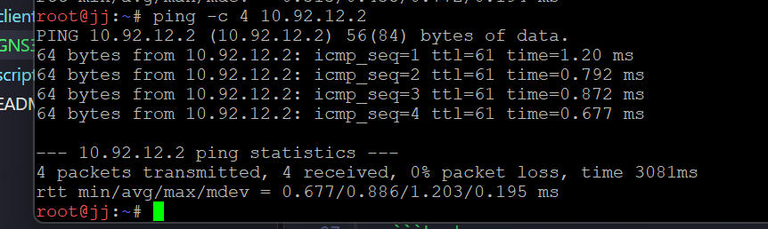

# Jarkom-Modul-4-2026-K-57

| | |
|---|---|
| **Nama** | : Riezco Eka Bayu Witantra & Sulthan Daffa Al Hasyimi |
| **NRP** | : 5027251057 & 5027251091 |
| **Kelompok** | : K-57 |
| **Mata Kuliah** | : JarKom |

---

## Ringkasan

Praktikum Modul 4 membangun jaringan **The Wired** berdasarkan topologi dan kebutuhan host yang diberikan. Soal meminta perhitungan alamat dan routing seefisien mungkin, serta memastikan semua node terhubung dan dapat saling melakukan ping. Metode yang digunakan berbeda untuk tiap platform: **VLSM di Cisco Packet Tracer** dan **CIDR di GNS3**.

Laporan ini membagi dokumentasi menjadi dua bagian: **1. CIDR** untuk pengerjaan GNS3 dan **2. VLSM** untuk pengerjaan Cisco Packet Tracer.

## 1. CIDR

### 1.1 Berkas Dokumentasi

| Lokasi | Isi |
|---|---|
| [`GNS3 - CIDR/script.sh-router.md`](<GNS3 - CIDR/script.sh-router.md>) | Script konfigurasi setiap router |
| [`GNS3 - CIDR/clientsh.md`](<GNS3 - CIDR/clientsh.md>) | Script IP dan gateway setiap client |
| [`GNS3 - CIDR/autostart.md`](<GNS3 - CIDR/autostart.md>) | Konfigurasi autostart |
| [`GNS3 - CIDR/cara test.md`](<GNS3 - CIDR/cara test.md>) | Checklist dan langkah pengujian |
| `Assets/GNS3/` | Gambar topologi, pembagian subnet, dan bukti pengujian |

### 1.2 Topologi dan Perencanaan Alamat

Topologi terdiri dari Cyberia sebagai router yang mengarah ke NAT, Wired sebagai router inti, dan router-router cabang. Jumlah kebutuhan host pada setiap subnet mencakup node akhir dan interface router yang terhubung ke subnet tersebut.

| Subnet | Network/prefix | Kebutuhan host | Gateway atau endpoint link | Node pada LAN |
|---|---|---:|---|---|
| A1 | `10.92.0.0/25` | 126 | Cyberia `10.92.0.1` | JJ, MyuMyu |
| A2 | `10.92.0.128/30` | 2 | Cyberia `.129`, Wired `.130` | Link Cyberia-Wired |
| A3 | `10.92.8.0/29` | 4 | Wired `.1`, Psyche `.2`, Copland `.3`, Schumann `.4` | Link router cabang |
| A4 | `10.92.12.0/22` | 881 | Psyche `10.92.12.1` | Kari, Lin |
| A5 | `10.92.16.0/26` | 32 | Copland `10.92.16.1` | Juri |
| A6 | `10.92.18.0/23` | 301 | Copland `10.92.18.1` | Masayuki |
| A7 | `10.92.20.0/29` | 4 | Schumann `10.92.20.1` | Akashic |
| A8 | `10.92.20.8/30` | 2 | Schumann `.9`, Aceta `.10` | Link Schumann-Aceta |
| A9 | `10.92.32.0/22` | 514 | Aceta `10.92.32.1` | Omnipresence, Denpa |
| A10 | `10.92.36.0/30` | 2 | Wired `.1`, Navi `.2` | Link Wired-Navi |
| A11 | `10.92.40.0/24` | 254 | Navi `10.92.40.1` | Alice, Reika |
| A12 | `10.92.41.0/26` | 58 | Navi `10.92.41.1` | Taro |
| A13 | `10.92.48.0/24` | 143 | Navi `10.92.48.1` | Yasuo, Miho, Kuma |
| A14 | `10.92.49.0/30` | 2 | Wired `.1`, Tachibana `.2` | Link Wired-Tachibana |
| A15 | `10.92.56.0/23` | 267 | Tachibana `10.92.56.1` | Collective, Ghost |
| A16 | `10.92.58.0/30` | 2 | Tachibana `.1`, Deus `.2` | Link Tachibana-Deus |
| A17 | `10.92.64.0/25` | 99 | Deus `10.92.64.1` | Lilith, Specter |
| A18 | `10.92.64.128/30` | 2 | Deus `.129`, Protocol7 `.130` | Link Deus-Protocol7 |
| A19 | `10.92.66.0/26` | 33 | Protocol7 `10.92.66.1` | Chisa, Hodgeson |
| A20 | `10.92.66.64/30` | 2 | Protocol7 `.65`, Knights `.66` | Link Protocol7-Knights |
| A21 | `10.92.72.0/29` | 3 | Knights `10.92.72.1` | Eri |
| A22 | `10.92.72.8/30` | 2 | Knights `.9`, Phantoma `.10` | Link Knights-Phantoma |
| A23 | `10.92.72.64/27` | 15 | Phantoma `10.92.72.65` | Semi |
| A24 | `10.92.72.96/30` | 2 | Phantoma `.97`, Shibuya `.98` | Link Phantoma-Shibuya |
| A25 | `10.92.80.0/26` | 62 | Shibuya `10.92.80.1` | Lain, Mika |

### 1.3 Perhitungan CIDR dan Routing

Prefix dipilih berdasarkan kebutuhan host pada tiap subnet. Untuk subnet LAN, jumlah alamat usable harus mencukupi host dan interface router; untuk link point-to-point digunakan subnet kecil seperti `/30`. Setelah subnet individual ditentukan, jaringan cabang diringkas menggunakan prefix bersama agar router inti tidak perlu menyimpan satu route untuk setiap LAN.

Contoh ringkasan route yang digunakan pada konfigurasi:

| Tujuan | Route ringkasan | Next hop |
|---|---|---|
| A5 dan A6 | `10.92.16.0/21` | Copland `10.92.8.3` |
| A7 dan A8 | `10.92.20.0/28` | Schumann `10.92.8.4` |
| LAN Navi A11-A12 | `10.92.40.0/22` | Navi `10.92.36.2` |
| Jaringan Deus dan cabang di bawahnya | `10.92.64.0/19` | Tachibana `10.92.49.2` |

Router cabang menggunakan default route ke router induknya, sedangkan Wired menyimpan route menuju cabang. Cyberia menjadi jalur keluar ke NAT; NAT masquerade dan IP forwarding dikonfigurasi di router tersebut.

### 1.4 Implementasi Konfigurasi

Script router mengaktifkan IP forwarding, memasang alamat pada interface, menambahkan route, dan mengatur NAT pada Cyberia. Script client memasang alamat statis dan default gateway sesuai subnetnya.

1. Pada node, edit file konfigurasi dengan `nano /root/script.sh` dan masukkan script yang sesuai.
2. Beri izin eksekusi dengan `chmod +x /root/script.sh`.
3. Jalankan konfigurasi dengan `bash /root/script.sh`.
4. Konfigurasi autostart dijelaskan di [`GNS3 - CIDR/autostart.md`](<GNS3 - CIDR/autostart.md>).

Script dan alamat lengkap per node tersedia pada [konfigurasi router](<GNS3 - CIDR/script.sh-router.md>) dan [konfigurasi client](<GNS3 - CIDR/clientsh.md>). Sebelum menjalankan script kembali, periksa alamat dan route yang sudah terpasang agar tidak terjadi penambahan duplikat.

### 1.5 Pengujian

Pengujian dasar menggunakan `ip -br addr`, `ip route`, serta `ping -c 4 <alamat-tujuan>`. Bukti yang tersedia menunjukkan hasil berikut:

| Sumber | Tujuan | Hasil pada bukti |
|---|---|---|
| JJ | Gateway A1 `10.92.0.1` | 4 paket diterima, 0% packet loss |
| Wired | Cyberia `10.92.0.129` | 4 paket diterima, 0% packet loss |
| JJ | Kari `10.92.12.2` | 4 paket diterima, 0% packet loss |

Panduan pengujian mencantumkan pemeriksaan tambahan untuk seluruh router, gateway client, komunikasi dalam satu LAN, lintas LAN, dan komunikasi dua arah. Bukti tangkapan layar untuk seluruh kombinasi tersebut belum disertakan, sehingga hasil tiga pengujian di atas tidak dianggap sebagai verifikasi lengkap semua node.

### 1.6 Catatan Sebelum Demo

- [`GNS3 - CIDR/script.sh-router.md`](<GNS3 - CIDR/script.sh-router.md>) masih memuat route `10.92.0.0/17` dari Cyberia ke Wired. Panduan pengujian menyebut route tersebut tidak perlu dipasang karena dapat mengirim seluruh prefix kembali ke Wired. Pastikan konfigurasi yang dijalankan sudah diselaraskan dengan panduan.
- [`GNS3 - CIDR/autostart.md`](<GNS3 - CIDR/autostart.md>) memanggil `/root/client.sh` untuk client, sedangkan contoh script client disimpan sebagai `/root/script.sh`. Samakan nama file agar konfigurasi client otomatis dijalankan.
- Beberapa label gateway pada [`GNS3 - CIDR/clientsh.md`](<GNS3 - CIDR/clientsh.md>) berbeda dari alamat yang dipakai dalam script. Tabel subnet pada laporan ini mengikuti alamat interface dan gateway pada script; cocokkan kembali label dokumentasi sebelum demo.
- Route A11-A12 pada Wired saat ini menggunakan `10.92.40.0/22`. Pastikan cakupan route tersebut memang diinginkan; dua subnet itu berada dalam `10.92.40.0/23`, yang merupakan ringkasan lebih ketat.

### 1.7 Kesimpulan

Perancangan GNS3 membagi prefix `10.92.0.0/17` menjadi 25 subnet dengan ukuran sesuai jumlah host dan kebutuhan link ant-router. Static route dan route summarization menghubungkan cabang melalui Wired, sementara Cyberia menyediakan koneksi ke NAT. Bukti yang tersedia mengonfirmasi konektivitas pada link router inti, gateway JJ, dan komunikasi lintas subnet JJ-Kari. Pengujian menyeluruh seluruh node tetap perlu diselesaikan menggunakan checklist pada [cara test.md](<GNS3 - CIDR/cara test.md>).

## 2. VLSM
